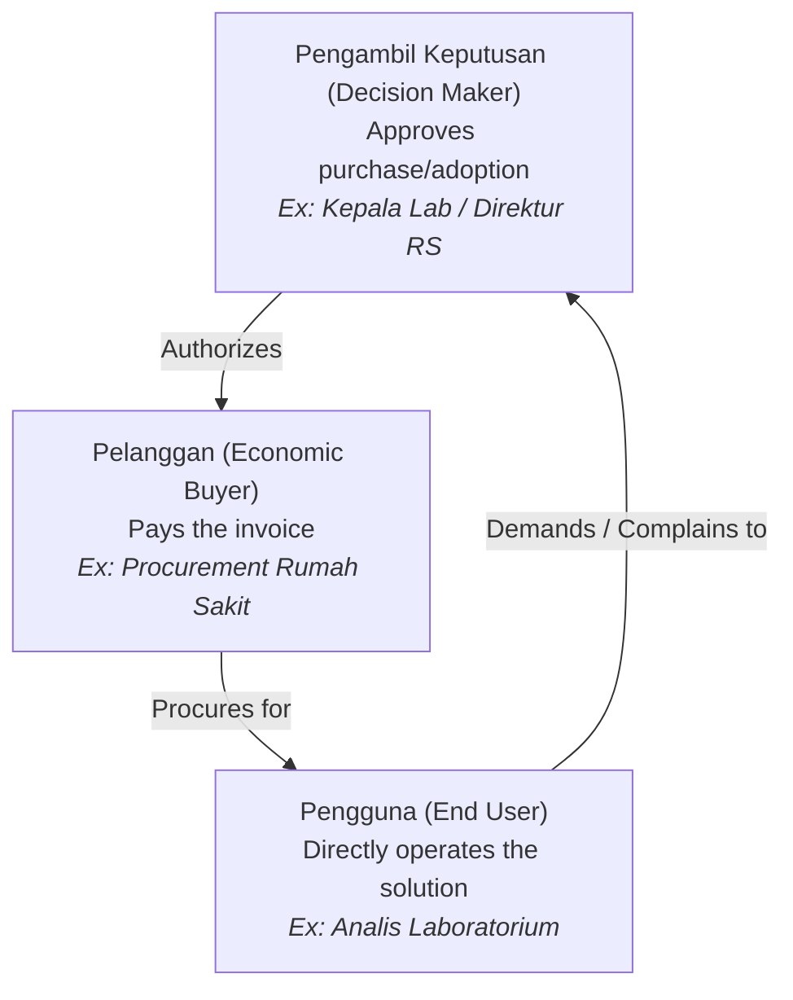
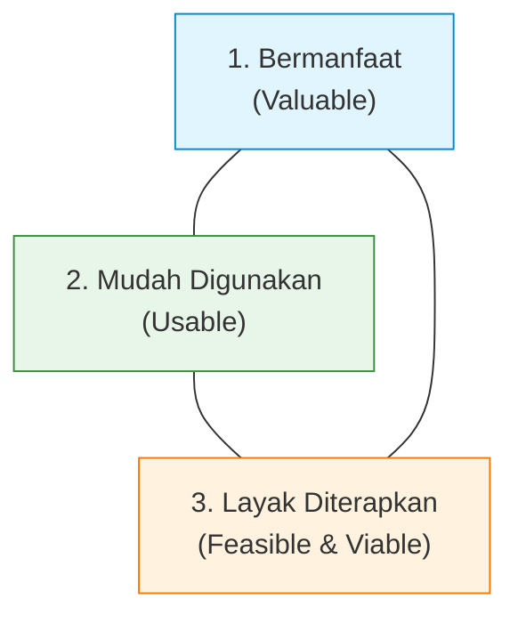

# Bootcamp Day 1 — Understanding User & Persona
## Turning Research & Academic Ideas into Real-Impact Solutions

- **Event:** GENOHACK 2026 · Bootcamp Deeptech Genomik
- **Date:** 17 October 2026
- **Speaker:** Muhamad Haikal Azhari (Co-Founder & CEO, Terrava)
- **Source File:** `Bootcamp D1 Material/User & Persona`
- **Context:** Disciplined Entrepreneurship Step 2 & 5 (End User Profile and Persona)

---

## Executive Summary

1. **Academic Idea vs. Market Reality:** Groundbreaking science fails in the market when founders build for abstract entities rather than specific human users.
2. **The Triad of Stakeholders:** A fatal error in deeptech and healthcare is failing to distinguish between:
   - **Pengguna (End User):** The person who physically interacts with the assay or software (e.g., lab technician, bioinformatician).
   - **Pelanggan (Customer/Buyer):** The institution or entity whose budget pays for the product (e.g., hospital procurement, clinic owner).
   - **Pengambil Keputusan (Decision Maker):** The authority who signs off, approves, or can veto adoption (e.g., Head of Pathology, Hospital Director, Ethics Committee).
3. **The SMUB Framework:** A structured validation framework to connect user pain to measurable evidence:
   - **S (Siapa):** Who is the specific user?
   - **M (Masalah):** What is their core pain point?
   - **U (Uji):** What minimal test will validate the solution?
   - **B (Bukti):** What KPI proves adoption success?
4. **Three Gates for Deeptech Adoption:** Innovation must be (1) Bermanfaat (Valuable), (2) Mudah Digunakan (Usable), and (3) Layak Diterapkan (Feasible in clinical/regulatory reality).

---

## Slide-by-Slide Content & Analysis

### Slide 1: Title Slide
- **Title:** Understanding User & Persona
- **Subtitle:** Turning research, academics, ideas into real-impact solutions.
- **Track:** GENOHACK 2026 Deeptech Genomics.

### Slide 2: Speaker Bio
- **Speaker:** Muhamad Haikal Azhari
- **Background:** Co-Founder of Terrava (PT Mitra Talenta Digital), specialist in tech-driven marketing frameworks and user-centric venture building.

### Slide 3: Regional Context & Network Specialization
- **Theme:** Building solutions grounded in real Indonesian operational realities — understanding distribution and behavioral differences from tier-1 metropolitan centers to regional cities across Indonesia.

### Slide 4: Academic Translation Pipeline
- **01 Master's Research:** Research on social media analytics, influencer behavior, and data frameworks.
- **02 Application:** Applying academic and empirical models to solve concrete commercial needs for brands and clients.
- **03 Business:** Building sustainable agencies and software ventures that generate real cash flow and customer value.

### Slide 5: The Daily Commute Case Study — Same Solution, Different Pains
Illustrates how different personas have completely distinct core problems despite needing the same underlying service (Ojek / Ride-Hailing):

| Persona | Core Pain / Worry | Desired Outcome |
| :--- | :--- | :--- |
| **Mahasiswa (College Student)** | Fear of being late for class; tight budget. | Fast, cheap, punctual transport. |
| **Pekerja (Corporate Worker)** | Unpredictable travel time; rush hour traffic stress. | Predictable arrival; ride reliability. |
| **Orang Tua (Parents)** | Safety of children; logistical hassle. | Trustworthy driver; hassle-free safety. |

*Takeaway:* "Butuh Ojek" (Needing a ride) is merely a feature request; the underlying value proposition differs dramatically across user personas.

### Slide 6: Section 1 — Who is Our Actual User?
- **Core Question:** *Siapa sebenarnya pengguna produk kita?* (Who actually uses our product?)
- **Warning:** Before designing software interfaces or diagnostic workflows, you must intimately understand the daily life of the person experiencing the friction.

### Slide 7: The WHO vs. HOW Diagnostic
- Never formulate a technical solution before answering:
  1. **WHO:** Who suffers from this friction?
  2. **HOW:** How do they currently cope or work around it today?

### Slide 8: The Stakeholder Triad — User, Customer, Decision Maker
Deeptech and biotech ventures rarely sell directly to end consumers. Founders must map three distinct roles:

1. **Pengguna (End User):** The person directly handling the reagent, pipetting the sample, or running the software.
   - *Example:* Analis laboratorium / bioinformatician.
2. **Pelanggan (Customer / Payer):** The institution or department whose budget line pays for the product.
   - *Example:* Bagian Pengadaan / Keuangan Rumah Sakit.
3. **Pengambil Keputusan (Decision Maker):** The executive with authority to approve, mandate, or veto the clinical tool.
   - *Example:* Kepala Departemen Patologi Anatomi / Komite Medis / BPJS reimbursement officer.

### Slide 9: Defining a Meaningful User Persona
A user persona is **not** an abstract demographic bullet list (e.g., "Female, age 25–40, likes reading"). A useful B2B/deeptech persona captures:
1. **Daily Job:** What tasks must they complete every day to do their job?
2. **Status Quo Workaround:** How do they currently solve the problem when your tool does not exist?
3. **Most Disruptive Pain:** What failure causes them severe stress, reprimand, or wasted hours?
4. **Selection Criteria:** What parameters do they evaluate when testing a new alternative?
5. **Adoption Barriers:** What fears or organizational habits prevent them from trying something new?

### Slide 10: Case Study — QRIS: One Product, Two Distinct Personas
- **Persona 1: Ibu Warung (Micro-Merchant)**
  - *Goal:* Accept customer payments without the hassle of counting change or handling dirty cash.
  - *Barriers/Anxieties:* Transaction confirmation delays, MDR transaction fees, spotty cellular connectivity.
- **Persona 2: Mahasiswa (Student Customer)**
  - *Goal:* Instant cashless checkout when wallet or ATM cash is empty.
  - *Barriers/Anxieties:* Slow app loading, payment timeout errors, server downtime.

### Slide 11: Section 2 — Does It Truly Solve the Problem?
- **Core Question:** *Apakah produk kita benar-benar dibutuhkan?* (Is our product genuinely needed?)
- Testing the difference between a "nice-to-have" curiosity and an "indispensable" operational requirement.

### Slide 12: The SMUB Framework
A structured 4-step framework to plan, test, and repair product concepts:

| Step | Indonesian | Description |
| :---: | :--- | :--- |
| **S** | **Siapa** | Who is the exact user persona we are committing to help? |
| **M** | **Masalah** | What specific, acute difficulty or operational bottleneck do they face? |
| **U** | **Uji** | What minimal testable solution or experiment do we put in front of them? |
| **B** | **Bukti** | How do we quantitatively know the solution succeeded? (Key Performance Indicator). |

### Slide 13: Worked Example of SMUB
- **S (Siapa):** Pekerja kantoran di area SCBD/Sudirman.
- **M (Masalah):** Sulit mendapatkan ojek online saat rush hour jam pulang kantor (hujan / macet).
- **U (Uji):** Layanan pemesanan transportasi cepat terjadwal via aplikasi.
- **B (Bukti / KPI):** Waktu tunggu berkurang dari 25 menit menjadi <7 menit; tingkat pembatalan (cancellation rate) turun 60%; 30-day retention >45%.

### Slide 14: The Adoption Paradox
- **Question:** *Mengapa inovasi yang secara teknis bagus belum tentu diadopsi pengguna?*  
  (Why do technically superior innovations fail to get adopted?)
- **Answer:** Superior science does not equal market viability. Adoption fails when friction exceeds user benefit.

### Slide 15: Three Non-Negotiable Adoption Conditions
For any deeptech/genomics product to achieve commercial adoption, it must fulfill three conditions:

1. **Bermanfaat (Solves a Real Problem):**
   - Does the innovation solve an observable, urgent pain?
   - Does it deliver tangibly superior outcomes compared to incumbent alternatives?
2. **Mudah Digunakan (Low Operational Friction):**
   - Can technicians or clinicians understand and execute the protocol without months of retraining?
   - Does it integrate seamlessly into existing laboratory workflows?
3. **Layak Diterapkan (Operationally & Economically Feasible):**
   - Do the reagent costs, equipment CAPEX, infrastructure requirements, and regulatory approvals permit sustainable use in real Indonesian hospitals?

### Slide 16: Transition Slide — Let's Practice
Hands-on team session to construct target personas for the hackathon tracks.

### Slide 17: The 5 Core Persona Discovery Questions
Teams must explicitly answer these 5 questions for their hackathon submission:
1. *Siapa Target Market dan pengguna spesifik produk Anda?* (Who is the target customer and specific end user?)
2. *Apa pekerjaan harian, kebiasaan, dan lingkungan kerjanya?* (What are their daily tasks, habits, and work environment?)
3. *Masalah apa yang paling mengganggu dan merugikan mereka?* (What is their most agonizing and costly pain point?)
4. *Bagaimana saat ini mereka menyelesaikan masalah tersebut?* (How do they currently solve or bypass it?)
5. *Apakah mereka bersedia memakai dan membayar produk Anda? Mengapa?* (Are they genuinely willing to adopt and pay for your solution? Why?)

### Slide 18: Summary — The 3 Ultimate Validation Questions
Before submitting your pitch deck, confirm you have empirical evidence for:
1. **Who:** Evidence that real humans actually suffer from this exact problem.
2. **Need:** Evidence that they actively seek and demand this solution.
3. **Action:** Evidence that they will switch from their status quo and pay for it.

### Slide 19: Closing
- Thank you / Q&A.
