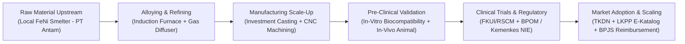
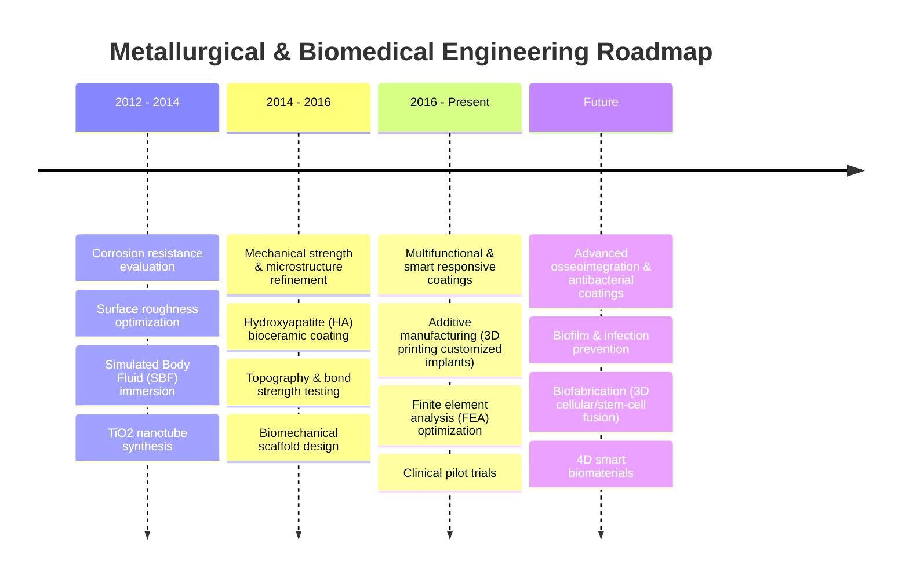
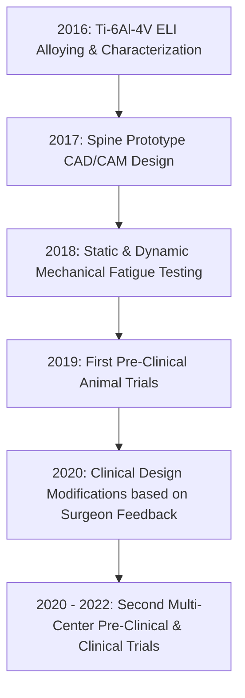
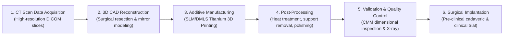

# From Research to Commercialization: A Medical Device Engineering Case Study
**Presenter:** Prof. Dr. Ir. I Nyoman Jujur, M.Eng  
**Affiliation:** Kelompok Riset Biomaterial Tulang dan Gigi, Pusat Riset Komposit dan Biomaterial, BRIN (Badan Riset dan Inovasi Nasional)  
**Contact:** inyo002@brin.go.id  
**Event:** GENOHACK 2026 Bootcamp — Day 2  
**Total Slides:** 22  

---

## Executive Summary & Translation Framework

This case study provides an end-to-end blueprint of translational deep-tech engineering and regulatory adoption in Indonesia, transitioning from laboratory metallurgical synthesis to clinical application, national regulatory authorization (NIE / Kemenkes), and public procurement (BPJS Kesehatan & E-Katalog). 

The presentation highlights how medical devices—specifically metallic bone implants (stainless steel 316L, Ti-6Al-4V ELI) and dental implants—navigate the "Valley of Death" through a strict tripartite partnership between **Research Institutions (BRIN / BPPT)**, **Clinical Academic Centers (FKUI / RSCM, Indonesian Dental Association / PDGI)**, and **Industrial Manufacturers (PT Zenith Allmart Precisindo, PT Pudak Scientific, PT Aneka Tambang)**.

---

## Slide-by-Slide Detailed Transcript

### Slide 1: Cover Slide
* **Title:** From Research to Commercialization: A Medical Device Engineering Case Study
* **Speaker:** Prof. Dr. Ir. I Nyoman Jujur, M.Eng
* **Organization:** 
  * Kelompok Riset Biomaterial Tulang dan Gigi (Bone and Dental Biomaterial Research Group)
  * Pusat Riset Komposit dan Biomaterial (Research Center for Composites and Biomaterials)
  * BRIN (Badan Riset dan Inovasi Nasional)
* **Email:** inyo002@brin.go.id
* **Program:** GenoHack 2026

---

### Slide 2: Introduction — The Clinical Problem & Market Need for Bone Implants
* **Headline:** The high rate of traffic accident injuries highlights the critical need for safe and affordable bone implants.
* **Epidemiological Evidence:**
  * In Indonesia (2018 data), motorcycles were involved in **73.9%** of the total **196,456** recorded traffic accidents.
  * Orthopedic trauma from high-energy road traffic accidents creates an immense burden of fractures requiring internal and external fixation devices.
  * Historical dependence on imported medical-grade implants leads to exorbitant healthcare costs, stock shortages, and unequal access across regional hospitals.
* **Reference Source:** Tribrata News Papua Polri (Traffic accident case reports).

---

### Slide 3: Introduction — The Growing Domestic Dental Implant Market
* **Headline:** Rising health and aesthetic awareness, backed by advanced tech, specialist care, and affordability, is fueling rapid growth in the domestic dental implant market.
* **Market Drivers:**
  * Implants offer a permanent, functional, and durable solution to tooth loss, particularly beneficial for Indonesia's growing aging population.
  * Previously, dental implant procedures were restricted to high-income patients due to 100% reliance on expensive imported fixture systems.
  * Domestic development of dental implants provides an opportunity for high-quality, biologically compatible, yet affordable clinical interventions.
* **Reference:** Hermina Hospitals Clinical Article ("Mengenal Implan Gigi").

---

### Slide 4: Engineering Pipeline: Definitions from Lab to Field
The presentation establishes the structural continuum of technological maturity:

| Phase | Core Definition & Operational Scope |
| :--- | :--- |
| **Engineering Research** | Applying fundamental theories, methods, and processes to discover novel phenomena and generate new technology. |
| **Technology Development** | Applying optimization and iteration to achieve the most efficient and technically feasible methods, processes, or products. |
| **Design and Build** | Translating technical parameters into detailed engineering blueprints and physical tooling to fabricate a material, model, or prototype. |
| **Operation** | Conducting operational testing, pilot-scale production, and real-world deployment under rigorous clinical/industrial environments. |

---

### Slide 5: Key Technology Research Focus Areas
To achieve successful industrial translation, the research program focuses on four interconnected pillars:
1. **Advanced Materials Development:** Synthesis of biocompatible metallic alloys and surface coatings meeting strict international standards.
2. **Strengthening Materials Technology:** Refining metallurgical processing (casting, heat treatment, forging) to optimize microstructures and eliminate mechanical failure.
3. **Strengthening Engineering Design:** Precision computer-aided engineering (CAD/CAM), finite element analysis (FEA), and stress simulation for patient-specific anatomical fit.
4. **Joint Operations with Industry Partners:** Early-stage co-development with domestic manufacturing enterprises to ensure commercial scalability and regulatory readiness.

---

### Slide 6: Biomaterials & Metallurgical Specifications: Industrial vs. Medical Grade 316L SS
* **Biomaterial Definition:** Materials designed to interact with biological systems to safely and effectively replace, repair, or enhance the function of human tissues and organs.
* **Critical Distinction:** Industrial stainless steel (ASTM A240) cannot be used in the human body due to toxic elemental leaching, corrosion, and residual magnetic ferrite phases. Implants must comply with ASTM F138 (bar/wire) and ASTM F139 (sheet/strip).

#### Comparison Table: Industrial vs. Medical Grade 316L Stainless Steel

| Chemical / Physical Parameter | Industrial Standard (ASTM A240) | Medical Grade Standard (ASTM F138 & F139) | Engineering / Clinical Significance |
| :--- | :--- | :--- | :--- |
| **Nickel (Ni)** | 10.0 – 14.0 % | 13.0 – 14.0 % | Narrowed higher range enhances elasticity, stabilizes austenitic matrix, and prevents phase transformation. |
| **Chromium (Cr)** | 16.0 – 18.0 % | 17.0 – 19.0 % | Higher Cr forms an ultra-stable passive chromium oxide ($Cr_2O_3$) protective layer against pitting corrosion. |
| **Molybdenum (Mo)** | 2.0 – 3.0 % | 2.25 – 3.0 % | Tightened Mo content increases resistance to pitting and crevice corrosion in chloride-rich human body fluids. |
| **Microstructure** | Contains residual ferrite | **Free of residual ferrite (Strictly Non-Magnetic)** | Residual ferrite creates localized galvanic cells causing in-vivo degradation and MRI incompatibilities. |
| **Raw Material Cost** | ~**$3.20 per kg** | ~**$25.00 – $30.00 per kg** | High price premium of medical grade reflects ultra-pure vacuum melting, slag refining, and strict inclusion limits. |

---

### Slide 7: 7 Core Technologies for Bone Implant Development
The BRIN biomaterials research roadmap spans 7 specialized orthopedic technologies:
1. **Plate and Screw System:** Dynamic compression plates, reconstruction plates, and cortical/cancellous bone screws.
2. **Spinal System:** Pedicle screws, connecting rods, crosslinks, and interbody spinal fusion cages.
3. **External Fixation System:** Clamps, pins, and external structural rods for stabilizing complex open fractures.
4. **Arthroplasty System:** Total hip and knee replacement modular prosthetic assemblies.
5. **Polymer Bone Cement:** Polymethylmethacrylate (PMMA) based cements for prosthetic anchoring.
6. **Bone Graft:** Synthetic and biological osteoconductive scaffolds for filling osseous defects.
7. **Intramedullary Nail System:** Interlocking nails for long-bone femoral and tibial fractures.

---

### Slide 8: 7 Core Technologies for Dental Implant Development
Parallel dental research addresses seven interrelated reconstructive technologies:
1. **Dental Implant Fixture:** Endosseous screw bodies engineered with micro-threaded cervical collars.
2. **Barrier Membrane:** Guided bone regeneration (GBR) resorbable and non-resorbable membranes.
3. **Bone Graft Materials:** Osteoinductive and osteoconductive granular bone substitutes.
4. **Dental Cement:** Adhesive biomaterials for crown and bridge fixation.
5. **Prosthetic Abutment & Crown (Mahkota Gigi):** Precision suprastructures and anatomical ceramic/metallic crowns.
6. **Surgical Placement Kits & Drills:** Specialized instrumentation for osteotomy preparation.
7. **Implant Surface Modification:** Nanoscale coatings to accelerate bone-to-implant contact (BIC).

---

### Slide 9: The Evolution of Research Focus: Past, Present, and Future Outlook
A decadal progression of research priorities:

---

### Slide 10: Plate and Screw System Commercialization Journey
A chronological roadmap showing how laboratory metallurgy transitioned into a licensed medical device:

* **2011 – 2014 (Applied Research):**
  * Industrial Business Study: Feasibility and market opportunity analysis for domestic bone implants.
  * BPPT (now BRIN): Development of metallurgy and manufacturing technology using local raw materials.
* **2015 (Technology Development):**
  * Standardization of 316L stainless steel alloy for implants utilizing domestic raw materials.
  * Comprehensive material characterization and ISO 10993 biocompatibility testing.
  * Formation of clinical collaboration with academic orthopedic surgical teams.
* **2016 (Design and Build):**
  * Production layout design and engineering scale-up.
  * Industrial trial production runs.
  * Optimization of investment casting and precision CNC tooling.
  * Development of functional device prototypes.
* **2017+ (Operation & Market Launch):**
  * Cleanroom and production facility certifications (CPAKB / ISO 13485).
  * Marketing authorization and product registration permit (**Nomor Izin Edar / NIE**) from the Ministry of Health (Kemenkes).
  * Listing on Government E-Katalog (LKPP).
  * Formal commercial product launch and hospital distribution.
  * Gas diffuser production technology patent granted (**Paten IDP 000081235**).
* **Key Commercial & Social Impacts:**
  * **Significant Cost Reduction:** Locally manufactured bone plates and screws cost substantially less than imported equivalents.
  * **Import Substitution:** Successfully met the volume demands of **BPJS Kesehatan**, conserving state healthcare foreign exchange reserves.

---

### Slide 11: Development of Stainless Steel Using Local Raw Materials
* **Industrial Collaboration:** Research partnership between BPPT/BRIN and **PT Aneka Tambang (Persero) Tbk (PT Antam)**.
* **Metallurgical Innovation:** Introducing Ferrochrome (FeCr) during the liquid metal refining stage directly at the **Pomalaa Ferronickel Smelter** in Southeast Sulawesi.
* **Value Addition:** Transformed raw domestic ferronickel (FeNi) into industrial-scale stainless steel alloying stock, multiplying the economic value-add of Indonesian mineral commodities.
* **Key Reference:** Jujur, I. N. (2005), *Development of Stainless Steel from Pomalaa Ferronickel*.

---

### Slide 12: Alloying of Medical-Grade SS 316L in 100 kg Induction Furnaces
* **Methodology:** Precise material charge balance calculations combining local FeNi, master alloys, and ferro-additives to achieve the tight chemical composition required by **ASTM F138 / ASTM F139**.
* **Equipment:** Successfully synthesized medical-grade ingots using a customized 100 kg medium-frequency induction furnace at pilot-scale facilities.
* **Reference:** Jujur, I. N. (2015), *Formulation and Melting Technology for Biomaterial Grade 316L Stainless Steel*.

---

### Slide 13: Mechanical Strength & Property Compliance for Medical Standards
* **Process Innovation:** Optimization of **Argon Gas Purging via Porous Ceramic Gas Diffusers** at the bottom of the ladle/crucible.
* **Metallurgical Mechanism:** Argon bubble flotation effectively purges non-metallic oxide inclusions and dissolved hydrogen/nitrogen, creating an ultra-clean steel with an isotropic, completely ferrite-free austenitic microstructure.
* **Intellectual Property:** **Paten IDP 000081235** (Jujur, I. N., dkk, 2022).

#### Mechanical Testing Validation Table

| Standard / Material | Yield Strength (MPa) | Ultimate Tensile Strength (MPa) | Elongation at Break (%) |
| :--- | :--- | :--- | :--- |
| **ASTM F 138 (Medical Grade)** | Min. 190 MPa | Min. 490 MPa | Min. 40 % |
| **ISO 5832-1 (Implants for Surgery)** | Min. 190 MPa | 490 – 690 MPa | Min. 40 % |
| **BRIN Research Result (Hasil Riset)** | **270 MPa** | **521 MPa** | **45 %** |

> **Key Finding:** The domestically produced 316L SS exceeded international standards across all mechanical metrics: **+42% higher yield strength** (270 vs. 190 MPa), ultimate tensile strength of 521 MPa, and extraordinary ductility (45% elongation), guaranteeing high structural fatigue life without catastrophic brittle failure.

---

### Slide 14: Biocompatibility Characterization (ISO 10993 Compliance)
To prove that locally synthesized alloys do not trigger adverse biological reactions:
* **In-Vitro Cytotoxicity Testing:** Cultured mammalian cells exposed to extract solutions showed cell viability >95%, demonstrating non-toxicity and excellent cytocompatibility.
* **In-Vivo Animal Implantation Studies:**
  * Implantation of bone pins into animal models (femur/tibia).
  * Evaluated at baseline (Day 0) and Day 30 post-implantation.
  * Histopathological examination demonstrated healthy peri-implant osteogenesis, zero foreign-body giant-cell granulomatous reactions, and no systemic toxic accumulation in liver, kidney, or spleen.
* **Reference:** Gustian, et al. (2018), *Biocompatibility and Histological Assessment of Local Medical-Grade 316L Stainless Steel*.

---

### Slide 15: Advancing Bone Implant Manufacturing Technology
* **Process:** Precision Investment Casting (Lost-Wax Casting) combined with Computer-Aided Mold Flow Simulation.
* **Achievement:** By simulating fluid dynamics, heat dissipation, and solidification patterns, gating and riser systems were optimized to eliminate shrinkage porosity and cold shut defects.
* **Productivity:** Yield increased to **60 – 80 defect-free implants per single casting cycle**.
* **Quality Assurance:** Full validation via Non-Destructive Testing (NDT) using industrial radiography (X-ray inspection) and dye penetrant testing.
* **Intellectual Property:** **Paten IDP 000065857** (Jujur, I. N., dkk).

---

### Slide 16: Spine System Development Pipeline & Tripartite Model
Developing advanced spinal fixation assemblies requires specialized titanium alloys (**Ti-6Al-4V ELI - Extra Low Interstitial**):

#### Multi-Stakeholder Division of Labor
* **BRIN (National Research Institution):** Material synthesis, Ti-6Al-4V ELI alloying, metallurgical characterization, biocompatibility testing, prototype performance validation.
* **FKUI / RSCM (Clinical Academic Partners):** Lead orthopedic spine surgeons provide clinical user requirements, surgical ergonomic feedback, risk analyses, and lead pre-clinical/clinical surgical trials.
* **PT Zenith Allmart Precisindo (Industrial Partner):** Precision 5-axis CNC machining, medical-grade ultrasonic cleaning, passivation, ISO Class 7 cleanroom packaging, and commercial production line scaling.

---

### Slide 17: Dental Implant Prototypes: Load Simulation & ISO 14801 Testing
* **Design Optimization:** Fixture geometry, pitch angle, and internal hex connection engineered in partnership with **PT Pudak Scientific** and the **Indonesian Dental Association (PDGI)**.
* **Finite Element Analysis (FEA):** Masticatory stress distribution simulated to identify critical stress concentrations at the implant neck and abutment screw.
* **Dynamic Fatigue Testing (ISO 14801):** Validated through cyclic loading tests ($5 	imes 10^6$ cycles at 30-degree angulation) simulating years of in-vivo chewing forces without structural loosening or fatigue fracture.
* **Reference:** Alam, et al. (2024), *Mechanical Performance and Fatigue Behavior of Locally Engineered Dental Implants*.

---

### Slide 18: Dental Implant Surface Engineering: SLA & Hydroxyapatite
Accelerating osseointegration (direct structural connection between bone and implant):
* **SLA Technology (Sandblasted, Large-grit, Acid-etched):**
  1. Coarse alumina ($Al_2O_3$) sandblasting produces macro-roughness ($20 – 40\ \mu	ext{m}$).
  2. Hot hydrochloric/sulfuric acid etching produces uniform micro-roughness ($2 – 4\ \mu	ext{m}$) for early osteoblast adhesion.
* **Hydroxyapatite (HA) Coating:** Dip-coating and electrochemical deposition of bio-active calcium phosphate layers.
* **Clinical Validation:** Animal jaw models evaluated by Oral & Maxillofacial Surgeons from PDGI.
* **References:** Adhitya, dkk. (2024); Rahmadani, dkk. (2020).

---

### Slide 19: 3D-Printed Personalized Patient-Specific Implants (PSI)
Moving beyond standard off-the-shelf sizes to custom 3D-printed titanium reconstructions:
* **Clinical Partner (Orthopedic Surgery):** Prof. Dr. Fauzi Kamal, Sp.OT(K) — FKUI / RSCM (Oncology orthopedic reconstructions).
* **Clinical Partner (Oral & Maxillofacial Surgery):** Syarifah Nova Amiza Zam, drg., Ph.D., Sp.BMM — RSUD Sultan Fatah (Craniofacial mandibular reconstructions).
* **Academic Research Cohort:** Doctoral researchers from FT Mesin UNDIP, FT UI, and FSM UNDIP.
* **Industrial Manufacturing Partner:** PT Zenith Allmart Precisindo (Additive manufacturing selective laser melting / SLM facilities).

---

### Slide 20: Mandibular Personalized Implant Workflow
The end-to-end clinical-to-manufacturing workflow for customized mandibular implants:

---

### Slide 21: Key Takeaways: From Research to Real-World Impact
Prof. Jujur summarizes the foundational principles of deep-tech biomedical translation:
1. **Scientific Discovery is the Foundation:** Novel metallurgy and biocompatibility science underpin all intellectual property.
2. **Engineering Transforms Science into Reliable Products:** Bridging the gap requires rigorous process control, precision tooling, and yield optimization.
3. **Rigorous Testing and Regulatory Compliance are Non-Negotiable:** Pre-clinical assays, ISO standards (ASTM F138, ISO 5832, ISO 14801, ISO 10993), and Ministry of Health NIE authorization are critical gating milestones.
4. **Collaboration Drives Commercialization:** Academic researchers cannot commercialize alone; early integration with clinical specialists (FKUI/RSCM/PDGI) and industrial manufacturers (Zenith/Pudak) is essential.
5. **Deep-Tech Delivers Meaningful Societal Value:** Lowering implant costs by 50–70% through domestic manufacturing empowers universal national healthcare (BPJS Kesehatan) and provides high-performance clinical solutions for all citizens.

---

### Slide 22: Closing Slide
* **Acknowledgment:** Thank you / GenoHack 2026.
