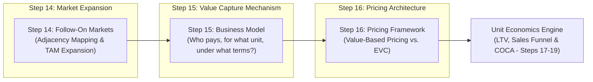
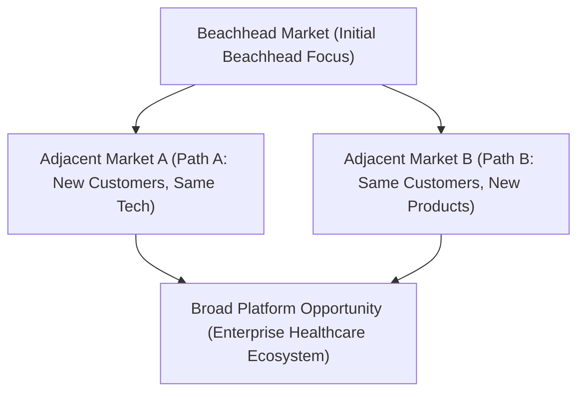
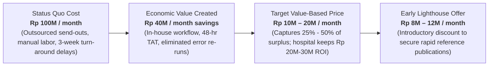

# Follow-On Markets, Business Model & Pricing: Disciplined Entrepreneurship Steps 14–16
**Event:** GENOHACK 2026 · BOOTCAMP Day 2  
**Date & Time:** Sunday, 18 October 2026 · 13:10 – 14:50 WIB  
**Venue:** ITB Ganesha Campus  
**Speaker:** Shelly Natalia (Experienced Finance & Commercial Professional, MIT Sloan Fellow / Alumnus)  
**Theme:** Theme 2C — Value Capture (Monetization Engine)  
**Total Slides:** 17  

---

## Executive Summary & Core Framework

This module covers the monetization continuum of Bill Aulet's **Disciplined Entrepreneurship (Steps 14 to 16)** tailored specifically to deep-tech, genomics, and life science ventures. It establishes that entrepreneurship is not about having a brilliant idea, but about systematically de-risking commercial execution until a repeatable, scalable business model emerges.



---

## Slide-by-Slide Detailed Transcript

### Slide 1: Cover Slide
* **Title:** GENOHACK 2026 · BOOTCAMP: Follow-On Markets, Business Model & Pricing
* **Subtitle:** Disciplined Entrepreneurship Steps 14–16 (MONETIZATION)
* **Date & Schedule:** 18 October 2026 · 13:10 – 14:50 WIB
* **Location:** ITB Ganesha Campus
* **Speaker:** Shelly Natalia (Experienced Finance & Commercial Professional, MIT)

---

### Slide 2: The Fundamental Principles of Deep-Tech Venturing
* **Core Philosophy:** "Entrepreneurship is not about having the best idea. It is about systematically reducing uncertainty until you have a repeatable, scalable business."
* **The Three Non-Negotiable Principles:**
  1. **Customer Before Product:** Deeply understand who owns the problem, why it is urgent and painful to them, and what workaround or status quo solution they currently deploy.
  2. **Value Before Monetization:** Quantify the exact economic, clinical, or operational value created before determining how to capture a percentage of it.
  3. **Evidence Before Investment:** Replace intuitive assumptions with structured customer discovery interviews, pretotype experiments, and measurable empirical traction.

---

### Slide 3: Step 14 — Think Big, Start Small
* **Core Concept:** Your beachhead market is merely the starting point — **not the final destination**.
* **Strategic Sequence:**
  * **Beachhead (Initial Market):** Narrow, dominant entry point where you achieve high market share, referenceable customer proof, and cash flow positive unit economics.
  * **Adjacent Markets:** Natural step-out segments leveraging existing assets.
  * **Broader Opportunity (Platform Vision):** The expansive long-term vision that justifies deep-tech venture-scale investment.



---

### Slide 4: Market Sizing Formulas (TAM, SAM, SOM)
To project follow-on expansion credibly without hand-waving:

$$	ext{TAM (Total Addressable Market)} = 	ext{Potential Customers in Target Segment} 	imes 	ext{Annual Revenue per Customer}$$

$$	ext{SAM (Serviceable Addressable Market)} = 	ext{TAM} 	imes \% 	ext{ of Market You Can Realistically Serve}$$

$$	ext{SOM (Serviceable Obtainable Market)} = 	ext{SAM} 	imes 	ext{Target Expected Market Share (Years 1–3)}$$

---

### Slide 5: Growing by Adjacency — Two Expansion Pathways
When scaling beyond the beachhead, startups must follow a disciplined adjacency path to avoid dividing organizational focus:

| Feature / Dimension | Path A: Market Expansion (Upselling to New Segments) | Path B: Product Expansion (Cross-Selling to Same Segment) |
| :--- | :--- | :--- |
| **Strategic Vector** | **Same Product $
ightarrow$ New Customer Segment** | **Same Customer Segment $
ightarrow$ New Product / Assay** |
| **Operational Mechanism** | Reuse the base product, validated assay, analytical workflow, and clinical evidence while acquiring a new category of buyers. | Maintain relationships with existing clinical accounts and introduce a secondary test, panel, or informatics service. |
| **Genomics Example** | A validated hereditary breast cancer assay transitions from Academic Hospitals to Private Regional Reference Laboratories. | An existing hospital partner already running your cancer panel adopts your new Pharmacogenomics (PGx) panel on the same sequencer. |

> **Critical Rule:** Never attempt to change **both** the product and the customer segment simultaneously unless driven by existential necessity. Dual-axis pivots create catastrophic operational friction.

---

### Slide 6: How to Prioritize Follow-On Markets (Evaluation Matrix)
Before allocating capital to adjacent opportunities, score target segments against six criteria:

| Evaluation Dimension | Core Strategic Question |
| :--- | :--- |
| **1. Core Leverage** | Does this market directly reuse your primary competitive advantage and technical moat? |
| **2. TAM Size** | Is the market sufficiently large to move the needle for revenue and valuation? |
| **3. Time to Win** | How long will it take to build clinical credibility, complete pilots, and win initial accounts? |
| **4. Investment Required** | What new regulatory approvals, capital expenditures, or specialized team capabilities are required? |
| **5. Competitive Defensibility** | Are incumbents entrenched, or is your value proposition structurally defensible? |
| **6. Strategic Fit** | Does dominating this market directly unlock subsequent high-value segments? |

*Note: Maintain directional clarity; market dynamics will evolve before you arrive, so avoid over-engineering static models.*

---

### Slide 7: Example — Genomics Venture Adjacency Map
An illustrative expansion roadmap for an Indonesian clinical genomics startup:

```mermaid
flowchart TD
    BH["BEACHHEAD MARKET<br/>Hospital-based Hereditary Cancer Panel (100 Top Hospitals)"]
    
    subgraph Path A: Same Product, Next Customers
        ADJ_A["Regional Diagnostic Reference Laboratories (200 Commercial Labs)"]
    end
    
    subgraph Path B: Same Customer, Next Products
        ADJ_B["Pharmacogenomics (PGx) Panel for Existing Hospital Accounts"]
    end
    
    subgraph Long-Term Platform
        PLAT["Full-Stack Clinical Genomic Workflow & Multi-Omics Precision Medicine"]
    end
    
    BH -->|Path A: Customer Adjacency| ADJ_A
    BH -->|Path B: Product Adjacency| ADJ_B
    ADJ_A --> PLAT
    ADJ_B --> PLAT
```

---

### Slide 8: Adjacency Map Financial Sizing (Indonesia Case Study)
Quantifying sequential market size unlocks an aggregate addressable market of **Rp 102 Billion**:

| Market Layer | Target Customer Base | Estimated Annual Revenue / Account | Total Addressable Market (TAM) |
| :--- | :--- | :--- | :--- |
| **Beachhead:** Hospital Hereditary Cancer Testing | 100 Hospitals | Rp 240,000,000 / year | **Rp 24,000,000,000 (Rp 24B)** |
| **Follow-on A:** Regional Diagnostic Labs | 200 Labs | Rp 300,000,000 / year | **Rp 60,000,000,000 (Rp 60B)** |
| **Follow-on B:** Additional Assays in Existing Hospitals | 100 Hospitals | Rp 180,000,000 incremental / year | **Rp 18,000,000,000 (Rp 18B)** |
| **Total Combined Sizing** | — | — | **Rp 102,000,000,000 (Rp 102B)** |

---

### Slide 9: Step 15 — Creating Value Is Not the Same as Capturing Value
* **Value Creation:** The tangible utility, efficiency, clinical accuracy, and economic savings delivered to the customer (e.g., saving clinician time, eliminating misdiagnoses, lowering hospitalization costs, reducing test turn-around time).
* **Value Capture:** The specific commercial mechanism by which a portion of that created value is returned to the company as recognized revenue and profit (e.g., reagent kits, software subscriptions, sample processing fees, licensing royalties).

---

### Slide 10: Business Model $
eq$ Pricing
A business model is the structural architecture of value capture; pricing is simply the specific number charged within that model. A comprehensive business model addresses three foundational questions:

1. **Who Pays?** Identify the true **Economic Buyer** — who often differs from the end-user (technician), primary decision maker (department head), or beneficiary (patient).
2. **What Do They Pay For?** Define the **Unit of Value**: per-test analyzed, per-instrument placed, monthly laboratory seat license, data volume, or clinical outcome milestones.
3. **How Does Payment Work?** Upfront CapEx, recurring OpEx subscription, pay-per-sample invoice, reagent-rental agreement, or risk-sharing royalty.

---

### Slide 11: Common Deep-Tech Business Model Archetypes

| Archetype | Operational Mechanics | Life Sciences & Deep-Tech Application |
| :--- | :--- | :--- |
| **1. Per-Test / Service Fee** | Charge a transactional fee each time a sample, assay, or diagnostic run is performed. | Centralized CLIA/CAP reference lab services; send-out genetic screening tests. |
| **2. Instrument + Consumables (Razor & Blade)** | Place capital hardware upfront (or via reagent rental) and capture recurring high-margin sales from proprietary consumables/reagents. | Automated liquid handlers, microfluidic cartridges, proprietary library prep kits. |
| **3. SaaS / Informatics Subscription** | Fixed periodic fee (monthly/annual) granting unlimited or tiered access to software analytics and interpretation databases. | Secondary & tertiary bioinformatics pipelines, clinical variant interpretation platforms. |
| **4. IP Licensing & Royalties** | Out-license patents, cell lines, proprietary primers, or algorithm algorithms in exchange for upfront fees and milestone royalties. | Novel diagnostic biomarkers, therapeutic target discovery, synthetic biology strains. |
| **5. Data & Analytics Access** | Aggregate de-identified genomic datasets and monetize insights through enterprise pharma/academic subscriptions. | Population biobanks, real-world clinical-genomic databases for targeted drug discovery. |
| **6. Hybrid Model** | Bundling multiple models to balance cash flow, barrier to entry, and lifetime retention. | Low upfront instrument lease + per-sample reagent kit fee + cloud software subscription. |

---

### Slide 12: How to Choose the Right Business Model
Startups must achieve dual alignment between **External Customer Fit** and **Internal Operational Fit**:

#### A. External Fit (Customer & Market Environment)
* *Value Delivery Dynamics:* How much economic value is generated, and how quickly does the customer realize it?
* *Budgetary Authority:* Does the purchase require hospital board capital expenditure (CapEx) approval or standard operational laboratory budget (OpEx)?
* *Regulatory & Reimbursement Constraints:* Is there an existing BPJS or private health insurance billing code, or is it out-of-pocket self-pay?
* *Switching Costs:* What legacy laboratory information management systems (LIMS) or standard operating procedures (SOPs) must be altered?

#### B. Internal Fit (Economics & Scalability)
* *Sales Funnel Friction:* Does the model create long procurement delays or rapid bottom-up adoption?
* *Unit Economics:* How does the model influence Customer Lifetime Value (LTV) and Cost of Customer Acquisition (COCA)?
* *Working Capital Requirements:* Does the company have the balance sheet to finance upfront hardware placement, or must cash be collected upfront?
* *Long-Term Defensibility:* Can the pricing and billing structure lock in customers and prevent commoditization?

---

### Slide 13: Comparative Evaluation of Three Common Models

| Evaluation Dimension | Per-Test Service (Outsourced) | Annual Site Subscription (SaaS) | Instrument + Consumables (In-House) |
| :--- | :--- | :--- | :--- |
| **Customer Friction** | **Low** (zero commitment, pay-as-you-go) | **Medium** (requires annual contract approval) | **High** (requires equipment installation & retraining) |
| **Upfront Revenue** | **Low** | **Medium** | **High** |
| **Recurring Revenue** | **Medium** (vulnerable to volume fluctuations) | **High** (predictable ARR) | **High** (locked-in reagent stream) |
| **Capital Requirement** | **Low** | **Low** | **High** (hardware inventory & financing) |
| **Workflow Control** | **Medium** | **High** | **High** |
| **Optimal Use Case** | Early customer discovery; uncertain or low initial test volume. | Stable, recurring lab operations with standard sequencing hardware. | Mature, high-throughput centralized clinical diagnostic laboratories. |

---

### Slide 14: Step 16 — Set a Pricing Framework
* **Guiding Principle:** Create a defensible, evidence-based **price range** rather than a false sense of mathematical precision.
* **The Seven Forces of Deep-Tech Pricing:**
  1. **Value Created:** Always anchor the price against the quantified economic value delivered to the buyer, never cost-plus markup.
  2. **Alternatives & Status Quo:** Compare your cost directly against what the laboratory currently spends (send-out fees, manual labor, delayed reporting).
  3. **DMU Purchase Thresholds:** Keep price points below bureaucratic tender thresholds (e.g., hospital departmental discretionary spending limits).
  4. **Product Maturity:** Early unproven deep-tech requires lighthouse customer discounts, performance warranties, or shared-risk pilots.
  5. **Willingness to Pay (WTP):** Private executive hospitals, public vertical referral centers, and regional research institutes exhibit vastly different price elasticity.
  6. **Marginal Cost Floor:** Ensure gross margins exceed 70–80% to absorb complex customer success, technical support, and regulatory overhead.
  7. **Strength of the Core:** A strong technical moat (proprietary Asian genomic database) justifies premium pricing against generic global panels.

---

### Slide 15: Value-Based Pricing in Practice: Genomic Workflow Case Study
Calculating the economic value surplus for a single private hospital laboratory site:



---

### Slide 16: Connecting Price to Unit Economics (Steps 15 to 19 Continuum)
A startup's monetization strategy directly dictates its operational unit economics:

$$egin{matrix}
	extbf{Business Model} & \longrightarrow & 	extbf{Pricing Framework} & \longrightarrow & 	extbf{Life-Time Value (LTV)} & \longrightarrow & 	extbf{Sales Funnel} & \longrightarrow & 	extbf{COCA} \
	ext{(How value is captured)} & & 	ext{(How much is charged)} & & 	ext{(What an account is worth)} & & 	ext{(How accounts are won)} & & 	ext{(Cost of Acquisition)}
\end{matrix}$$

> **Key Rule:** An expensive direct enterprise sales team cannot be deployed if your product is sold on a low-margin transactional per-test model. The business model, price, and sales process must operate in total mathematical alignment.

---

### Slide 17: Key Takeaways
1. **Reuse Your Core Across Adjacencies:** Follow-on markets should aggressively leverage your core intellectual property, altering only one operational variable (customer segment or product line) at a time.
2. **Business Model Precedes Pricing:** Decide the structural mechanism of value capture (unit charged, economic buyer, payment cadence) before establishing the price point.
3. **Select Your Value Unit Deliberately:** Charging per-sample vs. per-site subscription vs. reagent cartridge can create or permanently dismantle your competitive advantage.
4. **Price from Value, Not Cost:** Determine pricing based on measurable customer economic return (EVC), then validate against buying friction, alternative solutions, and marginal cost floors.
