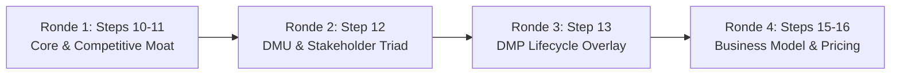
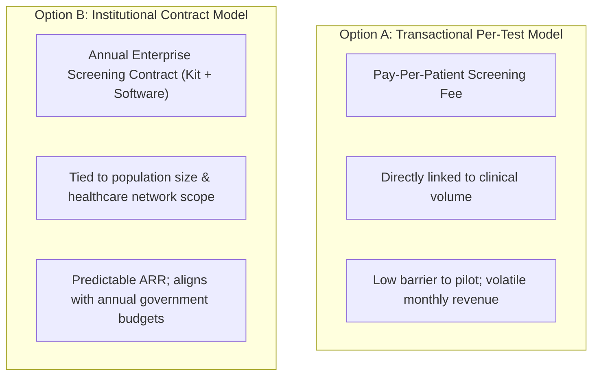

# Integrated Commercialization Workshop: Disciplined Entrepreneurship Steps 10–16
**Event:** GENOHACK 2026 · BOOTCAMP Day 2  
**Date & Time:** Sunday, 18 October 2026 · 15:35 – 16:20 WIB (45-Minute Intensive Breakout)  
**Theme:** Commercializing Deep-Tech Genomics & Life Science Ventures  
**Reference Benchmark:** The Nalagenetics Translational Case Study (Indonesia)  
**Total Slides:** 11  

---

## Workshop Overview & Objectives

The Day 2 Workshop bridges technical product development and commercial execution. Teams synthesize Bill Aulet's **Disciplined Entrepreneurship Steps 10 through 16** across four structured 10-minute sprints.



---

## Anchor Case Study: Nalagenetics (Indonesia)

### Profile & Real-World Traction (Slide 3)
* **Origins (2016):** Founded as a deep-tech spin-off from the **A*STAR Genome Institute of Singapore (GIS)**, led by Indonesian bio-entrepreneur **Levana Sani** (CEO).
* **Capital & Scale:** Raised **$12.6 Million Series A** funding; established operational partnerships with **40+ hospitals and diagnostic clinics** across Indonesia and Southeast Asia.
* **National Impact (Q4 2025):** Scaled to screen **16,000 leprosy (kusta) patients per year** under an official national screening program to prevent severe adverse drug reactions (dapsone-induced hypersensitivity syndrome via *HLA-B\*13:01* genotyping).
* **Product Ecosystem:** Affordable PCR/genotyping reagent kits, automated cloud bioinformatics pipelines, and clinician-facing Clinical Decision Support Systems (CDSS) for pharmacogenomics (PGx), nutrigenomics, and hereditary breast cancer risk.

---

## Slide-by-Slide Detailed Transcript & Team Exercises

### Slide 1: Cover Slide
* **Title:** Integrated Commercialization Workshop
* **Program:** BOOTCAMP Day 2 · Sunday, 18 October 2026 · 15:35–16:20 WIB
* **Target Audience:** All GENOHACK 2026 Track Teams

---

### Slide 2: Workshop Structure & 45-Minute Agenda
* **Round 1 (Steps 10–11):** Customer Priorities $
ightarrow$ Competitive Positioning $
ightarrow$ Core / Moat.
* **Round 2 (Step 12):** Decision Making Unit (DMU) — 3 Personas + Influencers + Veto Gatekeepers.
* **Round 3 (Step 13):** Decision Making Process (DMP) — Commercial overlay onto Full Life-Cycle.
* **Round 4 (Steps 15–16):** Business Model Selection & Value-Based Pricing Architecture.

---

### Slide 3: Indonesian Deep-Tech Benchmark — Nalagenetics
*(Full data documented in Case Study section above).*

---

### Slide 4: Case Study Example — Ronde 1: Core & Competitive Positioning
How Nalagenetics links customer priorities to an unassailable competitive moat:

```mermaid
quadrantChart
    title Competitive Positioning: Leprosy PGx Screening
    x-axis Bad Workflow Fit --> Good Workflow Fit
    y-axis Low Patient Safety Impact --> High Patient Safety Impact
    quadrant-1 Target Leadership (Nalagenetics)
    quadrant-2 Unfeasible in Clinic
    quadrant-3 Status Quo Failure
    quadrant-4 Dangerous / Inefficient
    "No Screening (Status Quo)": [0.15, 0.15]
    "Clinical Monitoring Only": [0.45, 0.35]
    "Broad NGS Sequencing": [0.25, 0.85]
    "Targeted HLA-B*13:01 Screening (Nalagenetics)": [0.85, 0.90]
```

* **Target Customer Priority #1 (Patient Safety):** Zero severe adverse cutaneous drug reactions (Stevens-Johnson Syndrome / Toxic Epidermal Necrolysis).
* **Target Customer Priority #2 (Workflow Fit):** Actionable clinical reporting delivered within 48 hours *before* the patient initiates multidrug therapy (MDT).
* **What Forms the Sustainable Moat?**
  1. Population-relevant Asian genomic variant frequency data.
  2. Highly targeted low-cost qPCR assay integrated into regional laboratory workflows.
  3. Seamless Clinical Decision Support Software translating genotypes into clear dosing recommendations.
  4. Institutional trust and clinical trial evidence established in collaboration with the Ministry of Health (Kemenkes).

---

### Slide 5: Case Study Example — Ronde 2: Decision Making Unit (DMU)
Mapping the human decision ecosystem for institutional adoption:

| Role in DMU | Specific Persona / Title | Core Operational Motivation | What Makes Them Say YES? |
| :--- | :--- | :--- | :--- |
| **End User** | Clinician / Puskesmas Healthcare Worker | Uses test result directly to prescribe safe treatment regimens. | Clear, binary, actionable reports (Prescribe vs. Alternative Drug); zero workflow hassle. |
| **Economic Buyer** | Government Program Owner / Hospital Director | Owns and authorizes budget allocations and public health expenditure. | Multi-center health economic evidence showing overall net healthcare savings per patient screened. |
| **Champion** | Clinical Pharmacologist / Public Health Lead | Pushes adoption internally across medical societies and committees. | Peer-reviewed clinical evidence, national health guidelines, and clinical prestige. |
| **Key Influencers** | Hospital Lab Team, Clinical Genetics Specialists, Professional Medical Associations (IDAI, PERDOSKI). | Ensure analytical validity, QA/QC standards, and professional guideline alignment. | Technical assay validation, high sensitivity/specificity, and seamless lab integration. |
| **Veto Gatekeepers** | Hospital Procurement Committee, BPOM / Kemenkes Regulators, IT Security Officers. | Assess legal compliance, distribution permits (NIE), and data privacy. | Valid regulatory clearance, TKDN compliance, and ISO 27001 data security compliance. |

---

### Slide 6: Case Study Example — Ronde 3: DMP Lifecycle Overlay
Overlaying commercial acquisition hurdles onto the 10-stage customer journey:

| Stage # | Lifecycle Stage | Customer Action | Key DMU Involved | Critical Commercial Friction | Risk Mitigation Strategy |
| :---: | :--- | :--- | :--- | :--- | :--- |
| **1** | **Need** | Adverse reaction risk recognized in clinic. | Clinician / Doctor | Low perceived urgency ("Adverse events are rare"). | Present local hospital incidence statistics. |
| **2** | **Find** | Discovers screening test exists. | Champion / KOL | Low awareness of local availability. | CME webinars and medical association symposia. |
| **3** | **Analyze** | Reviews scientific and clinical evidence. | Clinician + Lab Head | Skepticism regarding diagnostic accuracy. | Publish peer-reviewed Asian population validation data. |
| **4** | **Acquire** | Requests test procurement access. | Champion + Procurement | Complex hospital vendor registration hurdles. | Pre-list on government e-Katalog / regional distributor. |
| **5** | **Pay** | Approves budget and purchase order. | **Economic Buyer** | **Budget constraints; lack of reimbursement code.** | **Demonstrate net cost savings; subsidized trial kits.** |
| **6** | **Install** | Fits assay into standard laboratory workflow. | Lab Technicians & Ops | Long Turn-Around-Time (TAT); equipment mismatch. | Design for open PCR platforms; hands-on staff training. |
| **7** | **Use** | Runs test and interprets clinical report. | Clinician | Complexity in interpreting ambiguous variants. | Automated one-page Clinical Decision Support report. |
| **8** | **Value** | Assesses clinical outcomes and savings. | Program Lead & Buyer | Lack of aggregate institutional impact data. | Automated quarterly clinical outcome dashboard. |
| **9** | **Buy More** | Reorders screening kits for general cohort. | Economic Buyer | Discontinuous funding cycles. | Annual institutional multi-year service contracts. |
| **10**| **Tell Others**| Advocates adoption to other hospital networks.| Champion / KOL | Lack of formal advocacy platform. | Co-author national clinical implementation guidelines. |

---

### Slide 7: Case Study Example — Ronde 4: Business Model & Pricing
Comparing two distinct commercialization archetypes:



* **Pricing Logic:** $$	ext{Economic Value Created} \longrightarrow 	ext{Willingness to Pay} \longrightarrow 	ext{Competitive Alternatives} \longrightarrow 	ext{Final Price Point}$$

---

## Action Worksheets for Participating Teams

### Ronde 1: Step 10 & 11 Worksheet (10 Minutes)
*Goal: Identify Customer Priorities, Plot Alternatives, and Define Your Moat.*

```markdown
1. PRIORITY SELECTION (Based on Day 1 Primary Persona):
   - Priority #1: __________________________________________________
   - Priority #2: __________________________________________________

2. PLOT THE 2x2 COMPETITIVE MATRIX:
   - Y-Axis (Priority #1): [Low] ------------------------> [High]
   - X-Axis (Priority #2): [Low] ------------------------> [High]
   - Position Competitor A (Status Quo / Do Nothing): [X: ____, Y: ____]
   - Position Competitor B (Alternative 1):           [X: ____, Y: ____]
   - Position Competitor C (Alternative 2):           [X: ____, Y: ____]
   - Position YOUR VENTURE (Must be Upper-Right):     [X: ____, Y: ____]

3. DEFINE YOUR CORE / MOAT:
   - What is your Core? ____________________________________________
   - What is the single hardest element for competitors to replicate?
     _______________________________________________________________
   - Why cannot well-funded incumbents easily copy your position?
     _______________________________________________________________
```

---

### Ronde 2: Step 12 Worksheet (10 Minutes)
*Goal: Define the Human Decision-Making Unit (DMU).*

```markdown
1. END USER PERSONA:
   - Specific Human Name / Job Title: _____________________________
   - Top Operational Priority: _____________________________________
   - What makes them say YES? ______________________________________

2. ECONOMIC BUYER PERSONA:
   - Specific Human Name / Job Title: _____________________________
   - Budget Discretion / Cap: ______________________________________
   - Top Financial / Administrative Priority: _____________________
   - What makes them say YES? ______________________________________

3. CHAMPION PERSONA:
   - Specific Human Name / Job Title: _____________________________
   - Why do they want to lead internal change? ___________________
   - What makes them say YES? ______________________________________

4. INFLUENCERS & VETO GATEKEEPERS:
   - Key Influencer (Who shapes clinical opinion?): _______________
   - Veto Player (Who can unilaterally block the deal?): __________
```

---

### Ronde 3: Step 13 Worksheet (10 Minutes)
*Goal: Map the Commercial Process to Acquire a Paying Customer (DMP).*

```markdown
Review the 10 lifecycle stages for your venture:
[1. Need] -> [2. Find] -> [3. Analyze] -> [4. Acquire] -> [5. Pay] -> 
[6. Install] -> [7. Use] -> [8. Value] -> [9. Buy More] -> [10. Tell Others]

CRITICAL VULNERABILITY AUDIT:
- Identify the 2–3 specific stages where deals are most likely to stall:
  1. Stage ___: Risk: ________________________ | Mitigation: ________________________
  2. Stage ___: Risk: ________________________ | Mitigation: ________________________
  3. Stage ___: Risk: ________________________ | Mitigation: ________________________
- What specific regulatory, budgetary, or procurement milestone is required before Stage 5 (Payment)?
  ____________________________________________________________________________________
```

---

### Ronde 4: Steps 15 & 16 Worksheet (10 Minutes)
*Goal: Formulate Business Model Hypothesis & Value-Based Pricing.*

```markdown
1. BUSINESS MODEL HYPOTHESIS:
   - Who is the True Payer? ________________________________________
   - What is the Unit Charged for? (per test, site, subscription, kit):
     _______________________________________________________________
   - What specific Value is captured? ______________________________
   - Formal Statement:
     "[Payer: ______________] pays for [Unit: ______________] because 
      our solution delivers [Quantified Value: ______________________]."

2. VALUE-BASED PRICING SANITY CHECK:
   - Estimated Cost of Status Quo / Alternatives: Rp _______________ / month
   - Quantified Value / Cost Savings Created:      Rp _______________ / month
   - Proposed Customer Price Range:                Rp _______________ / unit
   - Gross Margin Floor (Must exceed 70%):         ______ %
```
