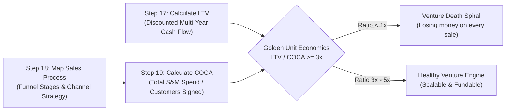
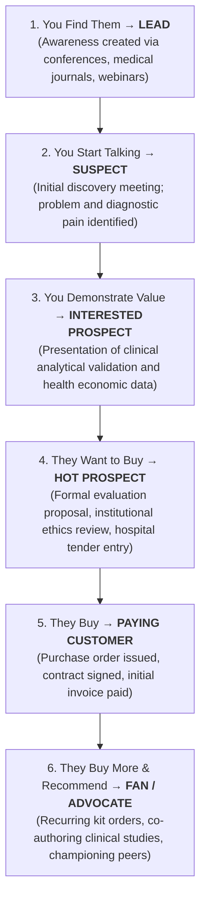

# Lifetime Value (LTV), Sales Process & Cost of Customer Acquisition (COCA)
**Program:** GENOHACK 2026 Bootcamp — Day 3  
**Theme:** Disciplined Entrepreneurship Steps 17, 18, and 19 (Unit Economics & Commercial Scalability)  
**Total Slides:** 31  

---

## Executive Summary & Economic Logic

Day 3 of the GENOHACK Bootcamp tackles the single most existential question for deep-tech ventures: **"Will your idea make money?"** 

In life sciences, diagnostic biotechnology, and genomics, a venture does not fail solely from technical failure in the laboratory; it fails when the cost of acquiring a paying hospital or laboratory customer exceeds the net gross profit that customer ever generates. This module establishes the mathematical relationship between **Step 17 (Lifetime Value - LTV)**, **Step 18 (Sales Process Mapping)**, and **Step 19 (Cost of Customer Acquisition - COCA)**.



---

## Administrative Context & Support Channels (Slides 1–5)

### House Rules for Collaboration
* **Be on Time:** Fast-paced sessions; rejoin promptly following working breaks.
* **Participate Actively:** Challenge assumptions constructively, share cross-disciplinary expertise.
* **Respect the Room:** Embrace diverse backgrounds across biology, clinical medicine, computer science, and business.
* **Protect Confidentiality:** Safeguard proprietary research, preliminary patent data, and institutional disclosures.
* **Hybrid Alignment:** Remote participants must be actively integrated into team discussions and decision voting.

### Official Operational Contacts
* **Juwita Windhasari (Event Contact):** `+62 856 4636 0110`
* **Muhammad Fayakun (Event Contact):** `+62 851 5922 1847`
* **Central Repositories:** Official WhatsApp Coordination Group & GENOHACK Participant Kit.

---

## Step 17: Lifetime Value (LTV) of an Acquired Customer (Slides 8–13)

### The Fundamental Rule of Unit Economics
> **"If selling costs more than you earn, you lose money on every customer!"**

Lifetime Value is the present discounted value of the cumulative gross profit a customer generates for your venture over their active commercial lifecycle.

### The 8 Foundational Questions to Estimate LTV
1. **Upfront Revenue:** What do they pay the very first time they purchase (capital equipment, installation, setup fee)?
2. **Recurring Revenue:** What do they keep paying each year (consumables, test kits, software subscriptions)?
3. **Expansion / Add-ons:** What high-margin extras, additional panels, or advanced services might they adopt later?
4. **Gross Margin:** After direct cost of goods sold (COGS: reagents, plastics, sequencing chips), what percentage is net gross profit?
5. **Retention / Churn Rate:** What percentage of accounts renew or continue ordering reagents year after year?
6. **Product Lifespan:** How many years until the customer must overhaul, upgrade, or replace their core hardware?
7. **Repurchase Likelihood:** What percentage will choose your venture again when their equipment reaches end-of-life?
8. **Cost of Capital / Discount Rate:** How much is a Rupiah received 3–5 years in the future worth today? (Accounts for startup venture risk).

---

### Step 17 Case Study: Genetic-Test Machine & Consumables Model
A regional reference laboratory purchases a benchtop genetic analyzer for hereditary screening. 

* **Hardware Purchase Price:** Rp 180,000,000 upfront (Year 0) with an 80% gross margin = **Rp 144,000,000 gross profit**.
* **Recurring Reagent Kits:** Rp 48,000,000 per year, delivering a constant gross margin.
* **Annual Retention Factor:** 90% retention per year ($100\% 
ightarrow 90\% 
ightarrow 81\% 
ightarrow 73\% 
ightarrow 66\% 
ightarrow 59\%$).
* **Cost of Capital Discount Factor:** Reflects ~50% early-stage deep-tech hurdle rate ($1.00 
ightarrow 0.67 
ightarrow 0.44 
ightarrow 0.30 
ightarrow 0.20 
ightarrow 0.13$).

#### Comprehensive Multi-Year Discounted Cash Flow Table

| Financial Metric | Today (Yr 0) | Year 1 | Year 2 | Year 3 | Year 4 | Year 5 | Aggregate Total |
| :--- | :---: | :---: | :---: | :---: | :---: | :---: | :---: |
| **Capital Machine Sale (Rp Juta)** | Rp 180 | — | — | — | — | — | Rp 180 Juta |
| **Test Reagent Kits / Year (Rp Juta)**| — | Rp 48 | Rp 48 | Rp 48 | Rp 48 | Rp 48 | Rp 240 Juta |
| **Active Customer Retention Share (%)**| 100% | 90% | 81% | 73% | 66% | 59% | — |
| **Gross Profit Generated (Rp Juta)** | **Rp 144** | **Rp 32** | **Rp 29** | **Rp 26** | **Rp 24** | **Rp 21** | Rp 276 Juta |
| **Present Value Discount Factor** | 1.00 | 0.67 | 0.44 | 0.30 | 0.20 | 0.13 | — |
| **Discounted Present Value (Rp Juta)**| **Rp 144** | **Rp 21** | **Rp 13** | **Rp 8** | **Rp 5** | **Rp 3** | **Rp 194 Juta** |

$$\mathbf{LTV = \sum_{t=0}^{5} 	ext{Present Value of Gross Margin}_t = Rp\ 194	ext{ Juta per Laboratory Customer}}$$

---

### Four Archetypal Deep-Tech Revenue Sources
* **A. Big One-Time Capital Sale:** Sequencers, specialized PCR readers, imaging hardware. Generates massive upfront cash flow but lacks recurring predictability.
* **B. Monthly Consumables & Refills:** Reagents, proprietary microfluidic cartridges, enzymes, test strips. Small transactional amounts that compound continuously over time.
* **C. Lab-as-a-Service (Centralized Processing):** Customer sends biospecimens; venture runs assays in-house and charges a pure service fee per sample. Zero client CapEx.
* **D. Cloud Software & Bioinformatics Data:** Automated interpretation portals, clinical decision support, variant calling APIs. Billed as monthly or annual recurring SaaS subscriptions.

---

## Step 18: Map the Sales Process & Go-To-Market Channels (Slides 14–18)

### How Selling Evolves Across Company Maturity
* **Early Days (Lighthouse Phase):** The Founders themselves must sell directly. High touch, labor-intensive, exploratory conversations required to uncover hidden objections and refine product-market fit.
* **Growing Phase (Repeatable Playbook):** Inside sales representatives, structured clinical pilot agreements, and digital lead generation streamline the funnel.
* **Mature Phase (Scale & Channel Leverage):** Established distributor networks, tender automation, inbound organic demand, and account-expansion upsells dominate.

---

### The Six Channel Archetypes in Life Sciences

| Channel Type | Operational Mechanics | Life Sciences & Healthcare Fit | Economic Friction |
| :--- | :--- | :--- | :--- |
| **1. Face-to-Face Field Sales** | Dedicated enterprise sales rep visits doctors, lab directors, and hospital committees in person. | Vertical academic hospitals, national reference labs, complex multi-million rupiah capital placements. | **Very High Cost:** Travel, high salaries, long enterprise procurement cycles. |
| **2. Inside Sales (Phone & Zoom)** | Virtual demonstrations, remote consultative calls, and digital contract execution. | Mid-sized private clinics, regional pathology labs, diagnostic testing centers. | **Medium Cost:** Faster cadence, lower travel overhead, high closing efficiency. |
| **3. Self-Service Digital Commerce** | Fully automated e-commerce web portal for ordering standard catalog items. | Standard PCR primers, catalog reagents, routine consumable refills, cloud software licenses. | **Near Zero Cost:** Completely automated, credit card or corporate invoice checkout. |
| **4. Third-Party Distributors** | Independent medical supply distributors manage warehousing, logistics, and local hospital relationships. | Broad geographic expansion across tier-2 and tier-3 Indonesian islands (Sumatra, Sulawesi, Papua). | **Margin Concession:** Fast distribution reach in exchange for giving up 20–35% distributor margin. |
| **5. Product-Led Growth (Freemium)** | Free initial software tier or entry-level genomic analysis tool that self-propagates via user invites. | Bioinformatics tools, genomic annotation browsers, academic research community workflows. | **Low Marginal Cost:** Virality drives customer acquisition without manual sales touches. |
| **6. Customer Success & Account Expansion** | Dedicated technical support specialists ensure laboratory workflows operate flawlessly post-sale. | Existing clinical hospital partners running genetic testing panels. | **High ROI:** Dramatically lowers churn, drives consumable reorder volume, and secures clinical referrals. |

---

### The 6-Stage Deep-Tech Sales Funnel



#### Critical GTM Question Checklist:
* *Funnel Progression:* What precise evidence or clinical milestone moves the account from one stage to the next?
* *Internal Approval:* Who inside the customer's organization (Lab Head, Medical Director, Purchasing Committee) must approve each step?
* *Dropout Friction:* At which stage will prospective accounts abandon the funnel, and how is that objection proactively engineered out of the process?

---

## Step 19: Cost of Customer Acquisition (COCA) (Slides 19–24)

### The Formal COCA Formula
COCA must capture **every single rupiah** invested in sales and marketing, divided strictly by the net new customers acquired during that specific accounting window:

$$\mathbf{COCA = rac{\sum 	ext{All Sales \& Marketing Expenses in Period } t}{	ext{Total Number of New Customers Acquired in Period } t}}$$

#### Comprehensive Expense Inclusions:
* **All Personnel Overhead:** Salaries, commissions, bonuses, and benefits for sales leaders, inside sales reps, and marketing staff.
* **Full Sales Cycle Time:** Factoring in the reality that early enterprise deals take 6 to 12 months of uncompensated effort before generating revenue.
* **The Cost of Discarded Leads ("No's"):** If only 1 in 4 evaluated hospitals signs a contract, the sales expenditures spent courting the 3 non-converting accounts must be absorbed by the 1 successful account.
* **Customer Contact Turnover:** Factoring in personnel shifts where an internal hospital champion departs, requiring a restart of the sales cycle.

---

### Step 19 Case Study: First-Year COCA Calculation (Genetic-Test Machine)
A genomic diagnostic startup executes its initial commercialization campaign over Year 1:

#### Annual Sales & Marketing Budget Breakdown

| Expenditure Item | Operational Scope | Annual Cost (IDR) |
| :--- | :--- | :--- |
| **Sales Leadership (Part-Time)** | Strategic commercial lead overseeing hospital contracts (0.5 FTE) | Rp 120,000,000 |
| **Field Sales Representative (Full-Time)** | Dedicated technical specialist conducting on-site hospital visits (1.0 FTE) | Rp 180,000,000 |
| **Medical Conferences & Exhibition Booths** | Trade booths at national pathology & oncology congresses | Rp 60,000,000 |
| **Doctor Educational Dinners & On-Site Demos**| Hands-on wet-lab workshops, CME dinners with key oncologists | Rp 100,000,000 |
| **Targeted Digital Marketing** | High-intent Google Search and LinkedIn professional targeting | Rp 40,000,000 |
| **Content Marketing & Clinical Whitepapers** | Production of local validation case studies, peer-reviewed reprints | Rp 30,000,000 |
| **Commercial Software & Sales CRM Stack** | Subscriptions to HubSpot CRM, Zoom Enterprise, outreach automation tools | Rp 20,000,000 |
| **Total Annual S&M Expenditure** | **Comprehensive Year 1 Commercial Budget** | **Rp 550,000,000** |

#### Acquisition Output & Unit COCA:
* **Total New Hospital Laboratories Acquired in Year 1:** **10 Labs**
* **Cost of Customer Acquisition (COCA):**

$$	ext{COCA} = rac{	ext{Rp 550,000,000}}{10	ext{ Laboratories}} = \mathbf{	ext{Rp 55,000,000 per Hospital Lab}}$$

---

### The Golden Ratio: LTV to COCA
Comparing the venture's lifetime value against its customer acquisition cost:

$$\mathbf{	ext{Unit Economics Ratio} = rac{	ext{LTV}}{	ext{COCA}} = rac{	ext{Rp 194,000,000}}{	ext{Rp 55,000,000}} = \mathbf{3.53	imes}}$$

```mermaid
quadrantChart
    title Unit Economics Health Spectrum (LTV / COCA)
    x-axis Insolvent / Fragile --> Highly Scalable / Capital Efficient
    y-axis High Risk --> Low Risk
    quadrant-1 Healthy Growth Engine (3x - 5x)
    quadrant-2 Underinvesting in Scale (> 5x)
    quadrant-3 Catastrophic Death Spiral (< 1x)
    quadrant-4 Dangerous Margin of Error (1x - 3x)
    "Our Case Study (3.53x)": [0.72, 0.78]
    "Status Quo Failure (<1x)": [0.15, 0.20]
```

#### Strategic Benchmarks:
* **$	ext{Ratio} < 1	imes$ (Insolvent):** You lose money every time you close a customer. More sales accelerate bankruptcy.
* **$	ext{Ratio} = 1	imes – 3	imes$ (High Risk):** Thin margins. Any slight increase in customer churn or sales cycle delays erases profitability.
* **$	ext{Ratio} = 3	imes – 5	imes$ (Healthy Benchmark):** The optimal gold standard for sustainable, venture-backable deep-tech growth.
* **$	ext{Ratio} > 5	imes$ (Under-investing):** The venture is moving too cautiously and leaving market share open for well-funded competitors to conquer.

---

### The Crossover Curve: Evolution of COCA vs. LTV Over Time

```mermaid
flowchart LR
    subgraph Phase 1: Early Days
        P1A["Very High COCA<br/>(Educating market from scratch)"]
        P1B["Low Initial Realized Cash"]
        P1A -.->|COCA > Revenue| P1C["Net Cash Deficit"]
    end
    subgraph Phase 2: The Crossover Point
        P2A["Inflection Milestone"]
        P2B["Word-of-mouth spreads; references validate clinical utility"]
    end
    subgraph Phase 3: Mature Scale
        P3A["Plummeting COCA<br/>(Inbound inquiries, standard SOPs)"]
        P3B["Compounding Recurring LTV"]
        P3B --> P3C["Massive Operating Profit Surplus"]
    end
    Phase 1 --> Phase 2 --> Phase 3
```

---

### Tactical Playbook: 8 Levers to Systematically Lower COCA
1. **Deploy Expensive Sales Reps Sparingly:** Reserve high-cost senior executives exclusively for complex hospital enterprise committees. Handle mid-tier accounts via virtual inside sales.
2. **Automate Digital Workflows:** Deploy automated lead nurturing sequences, automated reporting delivery, and digital self-service reagent reordering.
3. **Disqualify Unviable Prospects Aggressively:** Chasing uncommitted prospects who will never buy is the largest hidden cost in enterprise sales. Establish strict qualifying criteria.
4. **Target High-Intent Lead Generation:** Ten qualified leads from specialized clinical symposia yield higher ROI than 500 untargeted digital clicks.
5. **Accelerate Sales Funnel Velocity:** Shorten the duration between initial pitch and contract signing by providing pre-packaged hospital procurement dossiers and standardized validation data.
6. **Eliminate Pricing Friction:** Complex multi-variable pricing structures create legal and administrative paralysis. Transparent, standardized pricing accelerates procurement approvals.
7. **Harness Organic Reference Selling:** Highly satisfied clinical champions publish and speak at conferences, driving inbound customer referrals with zero acquisition spend.
8. **Dominate the Beachhead Before Expanding:** Deep geographic and clinical concentration within one hospital cluster generates localized network effects, slashing regional travel and sales overhead.

---

## Interactive Team Exercises & Action Worksheets (Slides 26–30)

### Exercise 1: Step 17 Lifetime Value (LTV) Calculation Worksheet
*Directions: Map out the expected cash flows and gross margins for your venture's primary customer.*

```markdown
1. UNIT REVENUE ARCHITECTURE:
   - Upfront Price per Customer (Hardware, Setup, Onboarding): Rp ____________________
   - Recurring Annual Spend (Consumables, Kits, Subscription):   Rp ____________________
   - Gross Margin Percentage on Sales:                           ________ %

2. 5-YEAR CASH FLOW & DISCOUNT PROJECTION:
   Year 0 (Today): Gross Profit Rp _____________ x Discount Factor (1.00) = Rp _____________
   Year 1:         Gross Profit Rp _____________ x Discount Factor (0.67) = Rp _____________
   Year 2:         Gross Profit Rp _____________ x Discount Factor (0.44) = Rp _____________
   Year 3:         Gross Profit Rp _____________ x Discount Factor (0.30) = Rp _____________
   Year 4:         Gross Profit Rp _____________ x Discount Factor (0.20) = Rp _____________
   Year 5:         Gross Profit Rp _____________ x Discount Factor (0.13) = Rp _____________

   AGGREGATE ESTIMATED LTV = Rp ________________________________ per Customer
```

---

### Exercise 2: Step 18 Sales Process & Funnel Architecture Worksheet
*Directions: Detail the exact customer conversion actions across all 6 stages.*

```markdown
1. IDENTIFY (Lead): How do target accounts first discover our solution?
   Action: __________________________________________________________________________

2. QUALIFY (Suspect): What criteria confirm they possess the clinical pain and budget?
   Action: __________________________________________________________________________

3. DEMONSTRATE (Interested): What specific clinical proof or demonstration is required?
   Action: __________________________________________________________________________

4. VALIDATE (Hot Prospect): What pilot trial or institutional review must occur?
   Action: __________________________________________________________________________

5. CLOSE (Customer): What formal contract, procurement tender, or PO secures payment?
   Action: __________________________________________________________________________

6. RETAIN & EXPAND (Advocate): How do we ensure daily usage and secure repeat reorders?
   Action: __________________________________________________________________________
```

---

### Exercise 3: Step 19 COCA & Unit Economics Health Check
*Directions: Tally your comprehensive Year 1 Go-To-Market budget and calculate acquisition cost.*

```markdown
1. ESTIMATED YEAR 1 SALES & MARKETING EXPENDITURES:
   - Sales & Business Development Personnel:       Rp ____________________
   - Conferences, Booths & Medical Congresses:    Rp ____________________
   - Clinical Demos, Wet-Lab Trials & CME Dinners: Rp ____________________
   - Digital Advertising & Professional Outreach: Rp ____________________
   - Content Development & Clinical Case Studies: Rp ____________________
   - Software Subscriptions, CRM & Sales Tools:   Rp ____________________
   TOTAL ANNUAL COMMERCIAL BUDGET:                 Rp ____________________ (A)

2. PROJECTED NEW ACCOUNTS SIGNED (YEAR 1):          ____________________ (B)

3. COST OF CUSTOMER ACQUISITION (COCA = A / B):    Rp ____________________ (C)

4. UNIT ECONOMICS RATIO (LTV / COCA):
   - Calculated Ratio: [LTV: Rp ___________] / [COCA: Rp ___________] = ______ x
   - Health Classification: [ ] <1x (Danger) | [ ] 1-3x (Risky) | [ ] 3-5x (Healthy) | [ ] >5x (Aggressive)
```
