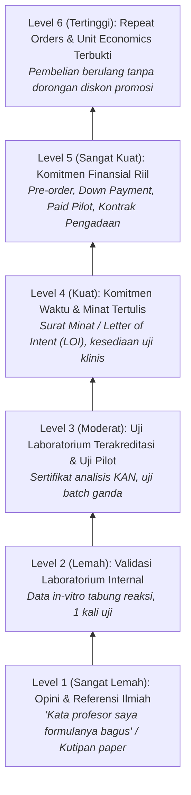
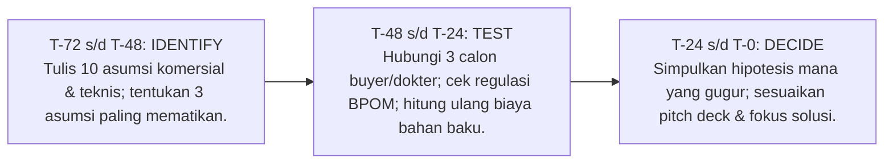

# Asumsi yang Paling Sering Keliru Saat Produk Bioteknologi Masuk Pasar Indonesia
**Narasumber:** Falasifah, S.Si (Co-Founder & Director of PT Alga Bioteknologi Indonesia - ALBITEC)  
**Program:** GENOHACK 2026 · Bootcamp 4  
**Tanggal:** Selasa, 20 Oktober 2026 · Sesi Guest Lecture Industri  
**Tema:** Perspektif Pelaku Industri Bioteknologi Nasional: Menghadapi Realita Pasar, Validasi Klaim, Regulasi, dan Kelayakan Finansial  
**Total Slide:** 24  

---

## Profil Narasumber & Perusahaan

* **Pembicara:** Falasifah, S.Si — Alumna Biologi Fakultas Sains dan Matematika (FSM) Universitas Diponegoro (UNDIP).
* **Perusahaan:** PT Alga Bioteknologi Indonesia (**ALBITEC**), didirikan tahun 2020.
* **Visi & Misi:** Mengembangkan budidaya mikroalga air tawar (*Spirulina sp.*) berkelanjutan sebagai sumber nutrisi fungsional, bahan baku kosmetik alami, pakan akuakultur tinggi protein, dan penyerap emisi karbon ($CO_2$).
* **Jejak Internasional & Pengakuan:** Showcase dan eksibisi bioteknologi di Jerman, Korea Selatan, dan Vietnam.
* **Media Sosial & Kontak:** Instagram `@spirulina.albitec`

---

## Paradigma Dasar: Mengapa Startup Bioteknologi Gagal? (Slide 5)

> **"Kegagalan jarang sekali terjadi karena sains-nya salah. Alasan nomor satu adalah asumsi pasar yang tidak pernah diuji secara empiris. Kas yang habis biasanya hanyalah akibat akhir."**

Berdasarkan analisis post-mortem terhadap 101 startup oleh **CB Insights**:
* **42% Gagal karena "No Market Need":** Membangun produk canggih yang tidak benar-benar dibutuhkan atau diprioritaskan oleh pasar.
* **29% Gagal karena "Ran Out of Cash":** Kehabisan modal kerja sebelum hipotesis teknis dan pasar berhasil divalidasi.
* **23% Gagal karena "Not the Right Team":** Komposisi tim tidak lengkap (terlalu dominan periset laboratorium tanpa eksekutor komersial dan regulatori).

---

## Empat Lensa Evaluasi Industri Bioteknologi (Slide 6)

Dunia bisnis dan industri menilai inovasi bioteknologi bukan hanya melalui tiga lensa klasik (Desirability, Feasibility, Viability), melainkan **empat lensa terpadu**:

```mermaid
quadrantChart
    title 4 Lensa Evaluasi Industri Bioteknologi
    x-axis Internal (Teknis & Biaya) --> Eksternal (Pasar & Hukum)
    y-axis Kepatuhan & Kelayakan --> Kebutuhan & Nilai
    quadrant-1 Desirability (Apakah mereka mau?)
    quadrant-2 Permissibility (Bolehkah dijual & diklaim?)
    quadrant-3 Feasibility (Bisakah dibuat konsisten?)
    quadrant-4 Viability (Apakah menguntungkan?)
    "Pasar & Masalah Klinis": [0.85, 0.85]
    "Regulasi BPOM, Halal & Etika": [0.85, 0.25]
    "Yield, Skala & Antar-Batch": [0.20, 0.25]
    "Unit Economics & Margin": [0.20, 0.75]
```

1. **Desirability (Apakah mereka mau?):** Siapa yang merasakan masalah secara akut, seberapa sering masalah itu muncul, dan apa alternatif status quo yang mereka pakai hari ini?
2. **Feasibility (Bisakah kita buat?):** Mampukah kita memproduksi secara konsisten antar-batch pada skala industri dengan biaya realistis?
3. **Viability (Apakah menguntungkan?):** Apakah harga yang dapat diterima pasar mampu menutup COGS, COCA, biaya registrasi, dan menyisakan margin laba bersih?
4. **Permissibility (Bolehkah dijual dan diklaim?):** Legalitas izin edar, validitas klaim label, sertifikasi halal, kepatuhan data genetik, dan etika riset. Sering kali menjadi penentu utama durasi *time-to-market*.

---

## Enam Asumsi Paling Sering Keliru di Bioteknologi Indonesia (Slide 7–10)

| Kategori | Asumsi Naif Periset / Startup | Realita Keras di Lapangan | Cara Industri Menguji dengan Cepat & Murah |
| :--- | :--- | :--- | :--- |
| **1. Desirability** | *"Produk kami bagus dan bernutrisi tinggi, pasti dicari dan dibeli orang."* | Konsumen tahu *Spirulina* adalah superfood, tetapi **mengetahui $
eq$ membeli ulang**. Rasa langu, bau amis khas alga, dan resistensi kebiasaan menahan repeat order. | Uji dengan sistem **Pre-order atau Down Payment (DP)** di muka. Lakukan sampling pada kanal riil dan ukur rasio pembelian ulang dalam 30 hari. |
| **2. Decision Making** | *"Pengguna produk adalah pembayar sekaligus pengambil keputusan pembelian."* | Di rumah sakit: dokter merekomendasikan, tetapi komite farmasi dan unit pengadaan e-Katalog yang memutuskan. Di pangan anak: anak mengonsumsi, ibu membayar, minimarket memilih stok. | Petakan **Decision Making Unit (DMU)** secara tertulis. Wawancarai setiap peran dan tanyakan: *"Siapa yang memiliki hak veto untuk menolak pembelian ini?"* |
| **3. Permissibility (Klaim)** | *"Hasil uji lab kami signifikan, berarti boleh langsung dicantumkan sebagai klaim kemasan dan iklan."* | **Peraturan BPOM No. 1/2022** mengatur secara ketat klaim gizi dan kesehatan. Seluruh materi iklan wajib identik dengan redaksi label yang telah disetujui saat pendaftaran izin edar. | Tulis draf klaim eksplisit, cocokkan matriks kategorinya dengan regulasi BPOM, dan konsultasikan ke biro regulatori sebelum mendesain materi visual. |
| **4. Feasibility (Konsistensi)** | *"Satu kali hasil uji laboratorium yang bagus sudah mewakili data performa produk."* | Cara dan lokasi sampling sangat mengubah data kuantitatif. (Contoh ALBITEC: kadar Omega-3 berbeda signifikan bila menguji telur utuh vs. hanya kuning telur). Variasi antar-batch adalah ancaman nyata. | Uji ulang menggunakan protokol baku yang sama persis dengan klaim yang diajukan, minimal dari 3 batch produksi berbeda, pada laboratorium terakreditasi KAN / ISO 17025. |
| **5. Permissibility (Izin Edar)** | *"Izin edar dan sertifikasi halal bisa diurus nanti setelah produk terbukti laku di pasar."* | **Wajib Halal** berlaku penuh per **18 Oktober 2026** (UU 33/2014 & PP 42/2024). Pengurusan izin BPOM memakan waktu berbulan-bulan dan membakar runway kas operasional tanpa pemasukan. | Petakan seluruh prasyarat registrasi (CPOTB / BPOM / Halal) sejak awal, hitung biaya dan durasinya ke dalam *financial runway*, dan desain produk agar masuk kategori izin yang paling efisien. |
| **6. Viability (Harga)** | *"Karena berbasis sains dan inovatif, pasar akan dengan senang hati membayar harga premium."* | Di rak toko atau rumah sakit, produk Anda langsung disandingkan dengan komoditas generik. Alasan harga premium harus dapat dijelaskan dalam hitungan detik, bukan satu halaman jurnal ilmiah. | Lakukan uji sensitivitas harga (*Van Westendorp Price Sensitivity Meter*) terhadap calon pembeli riil dengan menyandingkan langsung produk alternatif kompetitor. |

---

## Ilusi Ukuran Pasar (Slide 11)
* Terdapat **selisih hingga 58%** antara estimasi pasar *Top-Down* (berdasarkan laporan riset global yang mahal) dibandingkan realitas *Bottom-Down* yang dapat dijangkau oleh saluran distribusi lokal.
* Jangan mengalikan "1% dari 280 juta penduduk Indonesia". Hitung berapa unit yang benar-benar mampu diserap oleh kanal spesifik Anda dalam 12 bulan pertama.

---

## Tangga Bukti Validasi Industri (The Evidence Ladder) (Slide 12–13)

Industri dan investor venture capital memiliki hierarki pembuktian yang sangat tegas:



### 5 Metode Industri Menguji Asumsi Sebelum Peluncuran Skala Penuh:
1. **Wawancara KOL & Klinisi (1–2 Minggu · Biaya Rendah):** Mengonfirmasi apakah masalah yang diselesaikan merupakan prioritas klinis mendesak.
2. **Advisory Board Independen (Berkala · Biaya Rendah):** Mendapatkan tinjauan kritis dari pakar senior di luar tim pendiri untuk membongkar bias optimisme.
3. **Smoke Test / Pre-Order (2–4 Minggu · Biaya Rendah):** Menguji komitmen uang pembeli sebelum pabrik dibangun atau bahan baku dibeli massal.
4. **Pilot Terbatas (1–3 Bulan · Biaya Sedang):** Uji coba pada 1 rumah sakit, 1 kelompok tani, atau 1 jaringan apotek dengan kriteria kelulusan kuantitatif yang telah ditentukan sebelumnya.
5. **Pra-Konsultasi Regulatori (Sejak Hari Pertama):** Berdialog dengan auditor BPOM atau konsultan regulasi sebelum formula dan kemasan dikunci mati.

---

## Peta Cepat Asumsi Kritis per Track GENOHACKS 2026 (Slide 14)

| Track Hackathon | Asumsi Kritis yang Paling Sering Keliru | Siapa yang Harus Diwawancarai? | Uji Termurah yang Bisa Dilakukan Minggu Ini |
| :--- | :--- | :--- | :--- |
| **Track 1: Precision Diagnostics** | *"Hasil tes genomik pasti akan mengubah keputusan terapi dokter, dan ada institusi yang mau menanggung biayanya."* | Dokter spesialis onkologi/patologi, kepala laboratorium klinik, komite medik RS, bagian pengadaan RS. | Lakukan **5 wawancara klinisi mendalam**: tanyakan kapan terakhir kali mereka memesan tes serupa, kendala turn-around-time, dan siapa pembayarnya (BPJS vs. Asuransi vs. Out-of-pocket). |
| **Track 2: Food Security & Biodiversity** | *"Petani, peternak, atau pembudidaya pasti mau beralih menggunakan bibit/formula baru karena proyeksi kenaikan hasil."* | Petani, peternak, penyuluh lapangan (PPL), pengurus koperasi unit desa, perusahaan offtaker. | Susun **kalkulasi ROI per hektar atau per ekor** bersama 3 petani riil; bandingkan biaya bibit vs. risiko gagal panen. |
| **Track 3: Biomanufacturing & SynBio** | *"Biaya produksi enzim/biomolekul lokal kami di skala komersial pasti bisa bersaing melawan produk impor asal Tiongkok/India."* | Manajer pengadaan industri farmasi/makanan, contract manufacturing organizations (CMO). | Bangun **model Techno-Economic Analysis (TEA)** sensitivitas yield dan harga media kultur; tanyakan target harga beli maksimum (*ceiling price*) ke 2 calon pembeli industri. |

> **Konteks Kebijakan Nasional:**
> * **Inisiatif BGSi (Biomedical & Genome Science Initiative) Kemenkes:** Pemerintah sedang menggelontorkan infrastruktur pengurutan genomik nasional (termasuk penempatan mesin sekuensing mutakhir di SITH ITB).
> * **Pengadaan Pemerintah (E-Katalog):** Regulasi mewajibkan sertifikasi **TKDN + BMP $\ge 40\%$** dengan nilai **TKDN individu minimal 25%** agar produk farmasi dan alat kesehatan diprioritaskan dalam belanja APBN/BPJS.

---

## Regulasi, Legalitas, dan Etika: Wajib Dipahami Sejak Hari Pertama (Slide 15)

1. **Regulasi Klaim Label & Promosi:** **Peraturan BPOM No. 1/2022**. Klaim kesehatan, penurunan risiko penyakit, dan fungsi gizi wajib memiliki dasar uji klinis/laboratoris yang diakui. Iklan komersial yang menyimpang dari izin edar berisiko penarikan produk pidana.
2. **Kewajiban Sertifikasi Halal:** **UU No. 33/2014 & PP No. 42/2024**. Penahapan kewajiban bersertifikat halal untuk produk makanan, minuman, dan hasil sembelihan usaha mikro dan kecil (UMK) berlaku per **18 Oktober 2026**; usaha menengah dan besar telah berlaku sejak Oktober 2024. Mencakup pula obat, kosmetik, produk biologi, dan produk rekayasa genetika.
3. **Perlindungan Data Genetik & Kesehatan:** **UU No. 27/2022 tentang Perlindungan Data Pribadi (UU PDP)** (berlaku penuh Oktober 2024). Data kesehatan dan data genetika diklasifikasikan sebagai **Data Pribadi Spesifik** dengan standar enkripsi, informed consent, dan sanksi denda pidana yang sangat berat bila terjadi kebocoran data.
4. **Etika Riset Manusia:** Pengambilan sampel biologis manusia untuk validasi pasar wajib memiliki persetujuan etik (*Ethical Clearance*) dari Komite Etik Penelitian Kesehatan terakreditasi.

---

## Template Operasional: Dari Asumsi Menuju Uji Termurah (Slide 16)

Setiap tim hackathon wajib mengisi matriks 5 kolom berikut sebelum 23 Oktober:

$$egin{matrix}
	extbf{Asumsi Kunci} & \longrightarrow & 	extbf{Hipotesis Terukur} & \longrightarrow & 	extbf{Uji Termurah} & \longrightarrow & 	extbf{Kriteria Lolos} & \longrightarrow & 	extbf{Target Waktu} \
	ext{"Kami percaya..."} & & 	ext{"Jika [X], maka $\ge$ N..."} & & 	ext{Siapa, bagaimana, biaya} & & 	ext{Batas lulus vs. gagal} & & 	ext{Deadline & PIC}
\end{matrix}$$

#### Contoh Konkret ALBITEC (Inovasi Telur Spirulina Tinggi Omega-3):
* **Asumsi:** Ibu rumah tangga dengan balita bersedia membayar harga premium untuk telur berfortifikasi mikroalga yang kaya Omega-3 dan DHA alami.
* **Hipotesis Terukur:** Dari 50 ibu di 2 komunitas perumahan yang mencoba tester sampel telur, minimal 15 orang (**$\ge 30\%$**) melakukan pemesanan ulang berbayar dalam 30 hari.
* **Uji Termurah:** Penjualan langsung melalui reseller komunitas arisan dan pencatatan pesanan via WhatsApp Business. Biaya minim tanpa sewa toko.
* **Kriteria Evaluasi:** Jika pemesanan ulang $< 15$ orang, maka narasi promosi, penetapan harga, atau target segmen wajib dirombak total sebelum produksi diperbesar.

---

## Protokol 72-Hour Sprint Pra-Hackathon (Slide 20–21)



---

## Lima Prinsip Emas Membawa Deep-Tech ke Pasar (Slide 22–24)

1. **Mulai dari Buyer yang Sangat Spesifik, Bukan Semua Orang:** Jangan menargetkan "seluruh masyarakat Indonesia". Targetkan dokter spesialis onkologi di 5 rumah sakit rujukan utama.
2. **Klaim Harus Dibuktikan, Bukan Hanya Dideskripsikan:** Di mata regulator dan pembeli institusional, deskripsi teoritis tidak memiliki nilai tawar tanpa data pengujian batch yang tervalidasi.
3. **Spesifikasi dan Reproduksibilitas Menentukan Kesiapan Pasar:** Keberhasilan laboratorium pada satu tabung reaksi tidak berarti produk Anda siap dijual. Kemampuan memproduksi dengan variansi $<5\%$ adalah syarat mutlak industri.
4. **Uji Unit Economics Sebelum Investasi Modal Besar:** Hitung margin kotor dan harga bahan baku sebelum memesan bioreaktor atau mesin otomatis.
5. **Biarkan Data Membatalkan Asumsi Lebih Awal:** Menemukan bahwa pasar tidak mau membeli saat Anda baru menghabiskan Rp 500.000 untuk panggilan telepon jauh lebih baik daripada mengetahuinya setelah menghabiskan modal Rp 1 Miliar untuk membangun fasilitas produksi.

---

## Pesan Penutup & Kutipan Falasifah

> **"Pasar tidak membeli publikasi ilmiah Anda. Pasar membeli kepastian.**  
> **Jatuh cintalah pada masalah yang dihadapi oleh pelanggan, bukan semata-mata pada molekul, enzim, atau teknologi Anda — lalu uji asumsi termahal Anda selagi biayanya masih murah."**
