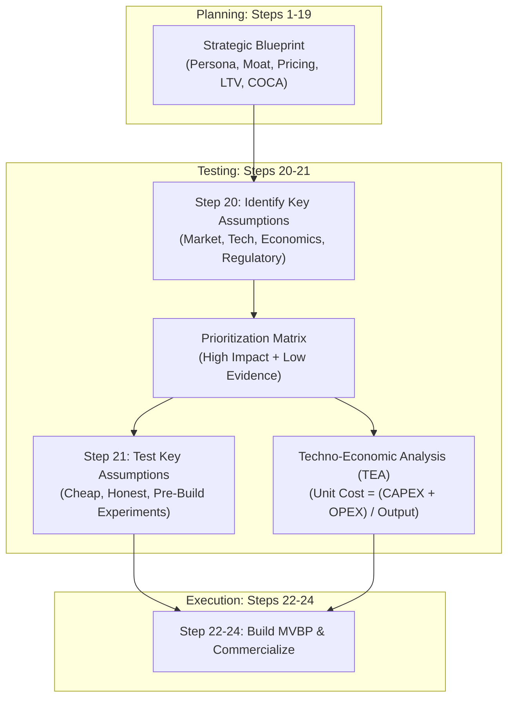
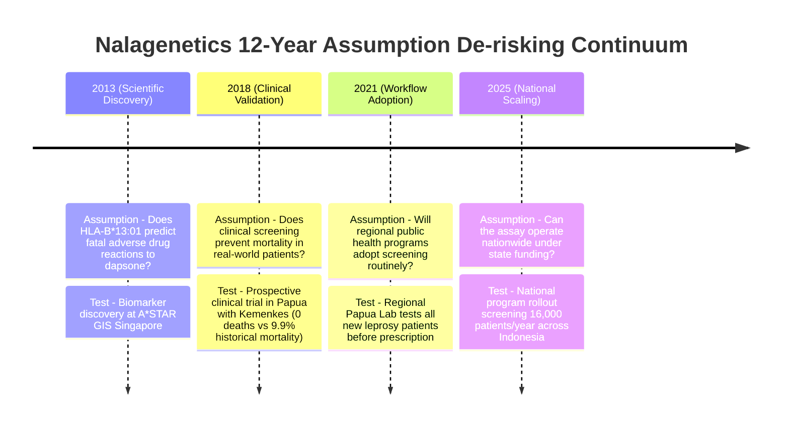
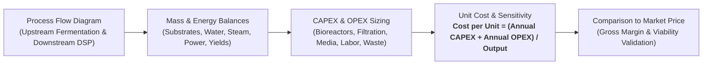
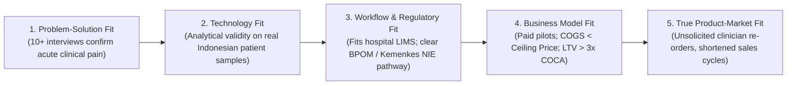

# Test Before You Build: Key Assumptions, Experiments & Techno-Economic Analysis (TEA) for Genomic Ventures
**Presenter:** apt. Suci Utami Nurwidia, S.Farm, MSc  
**Role:** Serial Entrepreneur · Entrepreneurial Ecosystem Builder · Lecturer · PhD Researcher (Leeds University Business School) · Co-founder SoluSEA Venture Labs · Founder Alture Harmoni Indonesia · Adjunct Lecturer SBM ITB  
**Contact:** suci@solusealabs.com · sucinurwidia@gmail.com · LinkedIn: Suci Utami Nurwidia · IG: `@suciunurwidia`  
**Event:** GENOHACK 2026 Bootcamp — Day 4  
**Date & Time:** Tuesday, 20 October 2026 · 19:00 WIB via Zoom  
**Theme:** Disciplined Entrepreneurship Steps 20 & 21 (De-risking Deep-Tech Ventures)  
**Total Slides:** 26  

---

## Executive Summary & Translation Framework

"Test Before You Build" represents the critical philosophical pivot of Bill Aulet's **Disciplined Entrepreneurship (Steps 20 and 21)**. In Steps 1 to 19, teams constructed a comprehensive strategic plan (Beachhead, Persona, Value Proposition, DMU, Pricing, LTV, COCA). However, **every number, preference, and willingness-to-pay assumption in that plan is currently an unproven hypothesis.**

Step 20 isolates the lethal assumptions that could destroy the venture if false, while Step 21 designs cheap, rapid, non-laboratory experiments to validate or invalidate them *before* capital is deployed to build physical infrastructure.



---

## Agenda & Takeaways (Slide 3)

### Session Schedule:
* **19:10 (Step 20):** Identifying Key Assumptions across 4 Deep-Tech Lenses (Interactive Poll).
* **19:19 (Step 21):** Testing Hypotheses Cheaply & Four Rules of Honest Experiments (Chat Waterfall).
* **19:26 (TEA & Viability):** Bioprocess Economics, Unit Cost Formula, and the 3 Core Viability Numbers.
* **19:33 (Translation & PMF):** TRL Progression, 5 Fit Stages, and Judging Panel Rubric Insights.
* **19:40 (Industry Spotlight):** Guest Case Study — Falasifah (Co-Founder & Director of ALBITEC).

### Deliverables Every Team Must Produce Before Friday, 23 October:
1. **Worksheet 20.1:** 5–10 prioritized key assumptions ranked by risk and severity of failure.
2. **Worksheet 21.1–21.2:** 3 lowest-cost test protocols with predefined, unambiguous pass/fail criteria (at least 1 test executed).
3. **Rough TEA Sketch:** Unit cost formula and identification of the top 3 sensitivity cost drivers.
4. **12-Month Commercialization Roadmap:** TRL position and clear milestones for tech, regulation, market, and capital.

---

## Opening Case Study: Nalagenetics Assumption Testing Journey (Slide 5)

Nalagenetics did not scale to a national screening program overnight; they systematically de-risked one existential assumption at each multi-year milestone:



---

## The Four Lenses of Deep-Tech Assumptions (Slide 7)

Unlike conventional software startups that primarily test user acquisition, genomics and deep-tech ventures must de-risk four distinct dimensions simultaneously:

| Assumption Dimension | Core Question | Life Sciences & Genomics Scope |
| :--- | :--- | :--- |
| **1. Market (Desirability)** | *Do they actually want it?* | Does the end-user (clinician/farmer) feel acute pain? Will the economic buyer authorize payment? Does it beat the status quo? |
| **2. Technical (Feasibility)** | *Can it be reliably engineered?* | Is the scientific mechanism valid? Does the primer/assay work on crude Indonesian patient samples? Is yield and titer stable across batches? |
| **3. Economic (Viability)** | *Is it profitable at commercial scale?* | Is cost-of-goods-sold (COGS) below the market ceiling price? Does unit cost hold up in a rigorous **Techno-Economic Analysis (TEA)**? |
| **4. Regulatory (Permissibility)** | *Is it legally and ethically allowed?* | Can it obtain Ministry of Health (Kemenkes) NIE or BPOM marketing authorization? How does it comply with Halal (UU 33/2014) and Data Privacy (UU PDP 27/2022)? |

> **Critical Trap:** Science-led teams instinctively spend 95% of their energy testing technical assumptions in the lab. In hackathons and investor pitches, **judges and venture capitalists almost exclusively drill down on Market, Regulatory, and Economic assumptions.**

---

## Step 20: Prioritizing Key Assumptions (Slide 8–10)

### The 2x2 Risk-Evidence Matrix
Not all assumptions warrant expensive testing. Plot every hypothesis on the matrix:

```mermaid
quadrantChart
    title Assumption Prioritization Matrix (Bland & Osterwalder, 2019)
    x-axis Strong Existing Evidence --> Thin / Zero Existing Evidence
    y-axis Low Impact if Wrong --> High Impact if Wrong (Catastrophic)
    quadrant-1 Priority 1: UJI DULU (Fatal Uncertainties)
    quadrant-2 Priority 3: Pantau (High Impact, Proven Evidence)
    quadrant-3 Priority 4: Abaikan (Low Impact, Proven)
    quadrant-4 Priority 2: Uji Bila Murah (Low Impact, Unproven)
    "HLA-B*13:01 predicts mortality": [0.15, 0.90]
    "Govt pays screening fee": [0.85, 0.92]
    "Clinicians adopt workflow": [0.80, 0.85]
    "Enzyme shelf-life > 6 mo": [0.60, 0.35]
```

### Worksheet 20.1: Nalagenetics Case Study (Track 1)

| # | Stated Venture Assumption | Related DE Step | Risk Level | Impact If Assumption Proves False |
| :-: | :--- | :-: | :-: | :--- |
| **1** | Carriers of the *HLA-B\*13:01* allele have a lethal risk of developing Dapsone Hypersensitivity Syndrome (DHS). | Steps 8, 10 | **Critical** | The product loses its foundational clinical rationale. Project terminates immediately. |
| **2** | National leprosy elimination programs are willing to introduce pre-treatment genetic screening into remote Puskesmas workflows. | Steps 2, 5, 12 | **Critical** | Zero clinical user adoption. The initial beachhead market collapses and must be replaced. |
| **3** | The Ministry of Health or regional government budgets are willing to reimburse/fund the test per screened patient. | Steps 15, 16 | **High** | Venture cannot rely on institutional public health procurement; must pivot to direct patient out-of-pocket pay. |

---

## Step 21: Designing Honest, Low-Cost Experiments (Slide 11–12)

### The Four Rules of Honest Deep-Tech Experimentation
1. **One Assumption, One Test:** Testing multiple variables simultaneously muddies results. Isolate the specific unknown.
2. **Predefine Pass/Fail Thresholds in Writing:** Without a quantitative threshold set in advance, confirmation bias will interpret any ambiguous customer comment as positive validation.
3. **Cheapest & Fastest First:** Before spending months synthesizing a molecule or writing complex code, a 15-minute phone call to a hospital procurement officer can validate if an imported reagent already dominates the price floor.
4. **Measure Behavior, Not Polite Opinions:** A doctor saying *"That sounds very interesting!"* is worthless. A doctor signing a letter of intent (LOI), committing laboratory time for a pilot, or paying a deposit is undeniable validation.

---

### Worksheet 21.1: Experiment Design Across All Three Tracks

| Hackathon Track | Stated Core Assumption | Lowest-Cost Test Protocol | Quantitative Pass/Fail Criteria | Speed & Estimated Cost |
| :--- | :--- | :--- | :--- | :--- |
| **Track 1: Precision Diagnostics** | Oncologists are willing to order an Asian-specific hotspot cancer panel instead of broad standard NGS. | Conduct 5 structured interviews with practicing surgical oncologists and pathologists using real clinical case vignettes. | **Pass:** $\ge 3$ of 5 oncologists confirm they would change therapy based on the result and state a specific turnaround time. | 3–5 Days<br/>$\sim$ Rp 0 (Phone/Zoom) |
| **Track 2: Food Security & Biodiversity** | Shrimp hatcheries will pay for early pathogen screening if testing takes $< 4$ hours on-site. | Present an assay workflow mock-up and target price sheet to 3 commercial hatchery managers; calculate avoided loss per pond. | **Pass:** $\ge 2$ hatcheries agree in writing to supply test samples for a pilot validation run. | 1 Week<br/>$\sim$ Rp 100,000 (Travel) |
| **Track 3: Biomanufacturing & SynBio** | Local industrial food/pharma manufacturers will switch from imported enzymes if local price is 20% lower. | Call procurement managers at 2 food/beverage processors; request exact current import specification sheets and volume tiers. | **Pass:** Procurement confirms target purchase volume and ceiling price specification ($/kg). | 2–3 Days<br/>$\sim$ Rp 0 (Phone calls) |

---

## Deep-Tech Techno-Economic Analysis (TEA) (Slide 13–15)

### What is Techno-Economic Analysis?
TEA translates biological process parameters (titer, yield, growth rate, reaction kinetics) into financial engineering numbers (CAPEX, OPEX, cost per unit). It bridges laboratory science and industrial commercial viability.



### The Universal TEA Cost Equation
$$\mathbf{	ext{Unit Cost} = rac{	ext{Annualized CAPEX} + 	ext{Annual OPEX}}{	ext{Total Annual Production Output}}}$$

### Three Critical Viability Metrics Every Founder Must Know (Slide 15):
1. **Gross Margin Percentage:**
   $$	ext{Gross Margin} = rac{	ext{Selling Price} - 	ext{COGS}}{	ext{Selling Price}} 	imes 100\%$$
   *Must be large enough ($>60–80\%$) to absorb ongoing R&D, clinical trial monitoring, regulatory filings, and enterprise sales cycles.*
2. **Unit Economics Ratio (LTV : COCA):**
   $$rac{	ext{Lifetime Value}}{	ext{Cost of Customer Acquisition}} \ge \mathbf{3 : 1}$$
   *Guarantees the enterprise sales engine generates sustainable free cash flow.*
3. **Breakeven Volume & Runway:**
   $$	ext{Breakeven Volume} = rac{	ext{Fixed Annual Operating Costs}}{	ext{Price per Unit} - 	ext{Variable Cost per Unit}}$$
   *How many diagnostic tests, screening samples, or kilograms of bioproduct must be sold annually to avoid operating losses? Does this volume exceed your beachhead TAM?*

---

## 12-Month Commercialization Roadmap: TRL Alignment (Slide 16)

Deep-tech ventures navigate Technology Readiness Levels (TRL) in Lockstep with Commercial Milestones:

| TRL Band | Development Phase | Core Hypothesis Tested | Evidentiary Milestone | Primary Funding Source |
| :---: | :--- | :--- | :--- | :--- |
| **TRL 1–3** | **Fundamental Research** | *Is the basic scientific mechanism correct?* | Peer-reviewed laboratory data, proof-of-concept publications. | Government research grants (BRIN, LPDP, BOPTN). |
| **TRL 4–5** | **Technology Proof of Concept** | *Does the assay/strain work in real patient/field samples?* | Functional prototype, analytical sensitivity/specificity data. | Innovation grants, translational hackathons (GENOHACK). |
| **TRL 6–7** | **Pilot Demonstration** | *Does it integrate into clinical workflow? Will buyers pay?* | Multi-center hospital pilot, signed LOIs, ethics/NIE dossier. | Seed venture capital, strategic corporate partners. |
| **TRL 8–9** | **Full Commercial Scale** | *Can manufacturing scale profitably and maintain QC?* | Registered NIE permit, ISO 13485 / CPOB, E-Katalog listing. | Series A/B venture capital, commercial revenue contracts. |

---

## The 5 Fit Stages of Deep-Tech Product-Market Fit (Slide 17)

In life sciences, Product-Market Fit is not an instantaneous event; it is achieved sequentially across five progressive stages:



> **Warning:** Skipping Stage 2 (Technology Fit on crude real-world samples) or Stage 3 (Workflow & Regulatory Fit) is the single most common cause of biotech startup collapse following a successful pilot.

---

## Judging Panel Evaluation Rubric: Criterion E (Slide 18)

GENOHACK judges evaluate **Criterion E (Validation and Evidence)** on a strict 1 to 5 scale (Accounting for 15% of total score):

* **Score 1 (Failing):** Zero external validation. Pure academic theory or ungrounded assumptions.
* **Score 2 (Marginal):** Validation limited strictly to internal team opinions or feedback from the hackathon problem owner mentor.
* **Score 3 (Acceptable):** 3 to 5 documented conversations with external end-users, clinicians, or problem owners.
* **Score 4 (Strong):** Hypotheses tested with objective written evidence; clear documented strategic pivot based on customer feedback.
* **Score 5 (Outstanding):** Concrete written commercial or clinical commitment: signed Letter of Intent (LOI), formal agreement to run a hospital pilot, or empirical blind test data.

---

## 48-Hour Rapid Pretotyping Protocol Before Hackathon (Slide 19–21)

Even if your solution was conceived during the hackathon, you can achieve a **Score 3 or 4** within 48 hours:

```markdown
1. MARKET TEST (12 Hours):
   - WhatsApp or phone 3–5 prospective users (oncologists, lab heads, farmers).
   - Inquire about actual current behavior: "How much did you spend on this test last month?"
   - Ask for a minor commitment: "If we deliver this at half the turnaround time, may we interview you for our pilot?"

2. TECHNICAL TEST (12 Hours):
   - In-silico bioinformatic validation: primer design, NCBI BLAST, public genomic dataset cross-referencing.
   - Request review from a technical mentor or university professor.

3. ECONOMIC TEST (12 Hours):
   - Inquire reagent, media, or consumable list prices from 2 commercial vendors (Sigma, Thermo, Qiagen).
   - Convert intuition into a defensible unit cost estimate.

4. REGULATORY TEST (12 Hours):
   - Consult an industry mentor: "Under what Kemenkes/BPOM category does this device or diagnostic fall?"
   - Document the specific regulatory pathway and estimated approval timeline.
```

---

## Bibliography & References (Slide 26)
* A*STAR Genome Institute of Singapore. (2025). *A*STAR spin-off NalaGenetics implements nationwide drug reaction screening for leprosy patients in Indonesia*.
* Aulet, B. (2024). *Disciplined Entrepreneurship: 24 Steps to a Successful Startup* (Expanded & Updated ed.). Wiley.
* Bland, D. J., & Osterwalder, A. (2019). *Testing Business Ideas*. Wiley.
* Constable, G. (2014). *Talking to Humans*. Giff Constable.
* Harrison, R. G., Todd, P. W., Rudge, S. R., & Petrides, D. P. (2015). *Bioseparations Science and Engineering* (2nd ed.). Oxford University Press.
* Mankins, J. C. (1995). *Technology Readiness Levels: A White Paper*. NASA.
* Maurya, A. (2012). *Running Lean* (2nd ed.). O'Reilly Media.
* Osterwalder, A., Pigneur, Y., Bernarda, G., & Smith, A. (2014). *Value Proposition Design*. Wiley.
