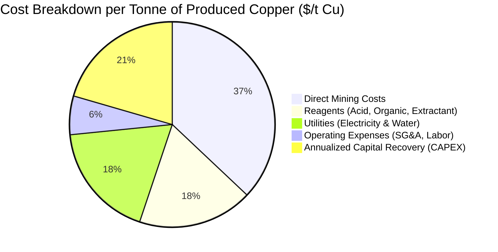

# Industrial Techno-Economic Analysis (TEA) Case Study: Copper Chalcopyrite Bioleaching
**Model Source:** `Orecast - Copper Chalcopyrite TEA Example.xlsx`  
**Developers:** Homeworld Collective & Recursion (formerly Conductor Labs)  
**Industry Application:** Industrial Biomining, Synthetic Biology & Biohydrometallurgy  
**Target Resource:** Low-Grade Chalcopyrite ($CuFeS_2$) Copper Ore  
**End Product:** LME Grade-A Copper Cathode ($99.99\%\ Cu$)  
**Context:** Reference Industrial TEA Model for GENOHACK 2026 Bootcamp Day 4  

---

## Executive Summary & Industrial Significance

This model provides a rigorous, full-scale industrial benchmark for **Techno-Economic Analysis (TEA)** in biotechnology and bioengineering. While developed for chalcopyrite biomining, its mathematical structure directly mirrors the unit-cost models required for Track 1 (Diagnostics assay cartridges), Track 2 (Agricultural bio-inputs), and Track 3 (Biomanufacturing fermentation).

The model evaluates a 20-million-tonne-per-year ($20\text{ MM t/yr}$) open-pit mining and heap bioleaching facility over a **30-year operational life**, coupling physical mass and energy balances with capital recovery factors (CRF) and sensitivity tornado analysis.

```mermaid
flowchart LR
    A["1. Run-of-Mine Ore<br/>(20 MM t/yr @ 0.40% Cu)"] --> B["2. Crushing & Sizing<br/>(Jaw crushers & vibrating screens)"]
    B --> C["3. Agglomeration & Inoculation<br/>(H2SO4 acid + Bioleaching microbes)"]
    C --> D["4. Engineered Heap Bioleaching<br/>(Bacterial iron/sulfur oxidation)"]
    D --> E["5. Pregnant Leach Solution (PLS)<br/>(Cu2+ enrichment)"]
    E --> F["6. Solvent Extraction (SX)<br/>(Organic extractant loading & stripping)"]
    F --> G["7. Electrowinning (EW)<br/>(Cathode plate electrodeposition)"]
    G --> H["8. 99.99% Cu Cathode<br/><b>36,936 Tonnes / Year</b>"]
```



---

## Key Baseline Operational & Production Parameters

| Operational Parameter | Model Value | Measurement Units | Description & Source |
| :--- | :---: | :--- | :--- |
| **Annual Ore Extraction** | 20,000,000 | Tonnes / year | Total ore + waste rock excavated from open-pit |
| **Annual Operating Days** | 330 | Days / year | Plant availability accounting for scheduled turnarounds |
| **Hourly Ore Feed Rate** | 2,525.25 | Tonnes / hour | Continuous crushing and agglomeration feed capacity |
| **Chalcopyrite Copper Grade** | **0.40 %** | % Cu in Ore | Low-grade refractory sulfide deposit |
| **Annual Copper Output** | **36,935.96** | Tonnes Cu / year | Metric tonnes of electrowon cathode copper produced |
| **Hourly Copper Production** | 4.66 | Tonnes Cu / hour | Steady-state plant metal recovery rate |
| **Benchmark Copper Price** | **$8,500.00** | $ / Tonne Cu | Baseline London Metal Exchange (LME) market price |
| **Equivalent Unit Price** | **$3.86** | $ / lb Cu | Normalized imperial benchmark price |

---

## Annualized Economic Summary & Income Statement

The baseline model demonstrates how capital intensity interacts with operating costs. At $8,500/t Cu, the base case yields a positive operating margin but a slightly negative net income after fully accounting for annualized capital depreciation, emphasizing the decisive role of bioleach yield improvements:



### Full Financial Summary Table

| Financial Metric | Annual Value (USD) | Cost per Tonne Cu ($/t) | Cost per Pound Cu ($/lb) | % of Gross Revenue |
| :--- | :---: | :---: | :---: | :---: |
| **Gross Sales Revenue** | **$313,955,686** | **$8,500.00** | **$3.86** | **100.00 %** |
| **Cost of Goods Sold (COGS)** | | | | |
| • Direct Mining Costs | $120,000,000 | $3,248.87 | $1.47 | 38.22 % |
| • Sulfuric Acid Consumption | $42,674,800 | $1,155.37 | $0.52 | 13.60 % |
| • SX Extractant & Organic Diluent | $16,000,000 | $433.18 | $0.20 | 5.10 % |
| • Electrical Power ($0.08/kWh) | $55,110,356 | $1,492.05 | $0.68 | 17.55 % |
| • Process Water & Consumables | $4,000,000 | $108.30 | $0.05 | 1.27 % |
| **Total COGS** | **$237,785,156** | **$6,437.77** | **$2.92** | **75.74 %** |
| **Gross Operating Margin** | **$76,170,530** | **$2,062.23** | **$0.94** | **24.26 %** |
| **Operating Expenses (OPEX)** | | | | |
| • Plant Labor & Management | $9,500,000 | $257.20 | $0.12 | 3.03 % |
| • Maintenance & Consumables | $6,237,627 | $168.88 | $0.08 | 1.99 % |
| • SG&A, Environmental Compliance | $4,000,000 | $108.30 | $0.05 | 1.27 % |
| **Total Operating Expenses** | **$19,737,627** | **$534.37** | **$0.24** | **6.29 %** |
| **Operating Income (EBITDA)** | **$56,432,903** | **$1,527.86** | **$0.69** | **17.97 %** |
| **Annualized Capital Cost (CAPEX)** | **$66,459,541** | **$1,799.32** | **$0.82** | **21.17 %** |
| **Simplified Net Income (EBIT)** | **-$10,026,638** | **-$271.46** | **-$0.12** | **-3.19 %** |

---

## Capital Expenditure (CAPEX) & Financing Architecture

The total upfront installed capital expenditure is **$763,112,504**, annualized using a **Weighted Average Cost of Capital (WACC)** and **Capital Recovery Factor (CRF)**:

### 1. Capital Financing Structure
* **Debt Funding Ratio:** 60.0% at an interest rate of 8.0% (after-tax debt cost: 6.32%).
* **Equity Funding Ratio:** 40.0% with an expected hurdle rate of 10.0%.
* **Corporate Income Tax Rate:** 21.0%.
* **Economic Project Life:** 30 Years.
* **Weighted Average Cost of Capital (WACC):**
  $$	ext{WACC} = (0.60 	imes 6.32\%) + (0.40 	imes 10.0\%) = \mathbf{7.79\%}$$
* **Blended Capital Recovery Factor (CRF):**
  $$	ext{CRF} = rac{r(1+r)^n}{(1+r)^n - 1} = rac{0.0779(1.0779)^{30}}{(1.0779)^{30} - 1} = \mathbf{0.08709}$$
* **Annualized CAPEX Charge:**
  $$	ext{Annualized CAPEX} = \$763,112,504 	imes 0.08709 = \mathbf{\$66,459,541	ext{ / year}}$$

### 2. Major Equipment & Plant Unit Operations Breakdown

| Process Area | Primary Equipment & Systems | Installed Cost (USD) | % of Total CAPEX |
| :--- | :--- | :---: | :---: |
| **Extraction & Pre-Strip** | Open-pit mining pre-stripping, heavy haul fleet, shovels | $277,944,585 | 36.42 % |
| **Crushing & Sizing** | Primary jaw crushers, secondary cone crushers, screens | $6,037,492 | 0.79 % |
| **Agglomeration & Inoculation** | Rotating agglomeration drums, microbe culture mixing tanks | $3,438,130 | 0.45 % |
| **Bioleach Heap Pads** | Engineered HDPE lined pads, irrigation piping, aeration blowers | $145,200,000 | 19.03 % |
| **Solvent Extraction (SX)** | Mixer-settlers, organic storage tanks, coalescence filters | $84,500,000 | 11.07 % |
| **Electrowinning (EW)** | Polymer concrete cells, lead anodes, stainless steel mother blanks | $122,800,000 | 16.09 % |
| **Utilities & Balance of Plant** | Acid storage, substations, water treatment, Lang scalar (2.02x) | $123,192,297 | 16.14 % |
| **Total Initial Capital (CAPEX)** | **Turnkey Plant Construction & Commissioning** | **$763,112,504** | **100.00 %** |

---

## Sensitivity & Tornado Analysis (Key Technical Drivers)

The TEA spreadsheet incorporates a dedicated **Tornado Sensitivity Engine** (`tornado` sheet) testing the economic impact of perturbing model parameters across Low, Mid, and High values:

```mermaid
flowchart TD
    subgraph Highest Sensitivity Drivers (Greatest Economic Leverage)
        D1["1. Copper Market Price: $8,300 to $8,700/t (+/- $14.8M EBIT)"]
        D2["2. Bioleach Copper Extraction Yield: 65% to 80% (+/- $22.4M EBIT)"]
        D3["3. Sulfuric Acid Recycling Efficiency: 60% to 75% (+/- $8.5M EBIT)"]
    end
    subgraph Moderate Sensitivity Drivers
        D4["4. Ore Grade: 0.38% to 0.42% Cu (+/- $7.2M EBIT)"]
        D5["5. Electricity Tariff: $0.06 to $0.10/kWh (+/- $6.9M EBIT)"]
        D6["6. Bioleach Reaction Kinetics: Accelerated leaching cycle time"]
    end
```

### Tornado Input Ranges Matrix

| Model Driver | Baseline (Mid) | Low Case | High Case | Direct Impact on Commercial Viability |
| :--- | :---: | :---: | :---: | :--- |
| **Bioleach Extraction Yield** | **70.0 %** | 65.0 % | 78.0 % | A 5% yield increase transforms EBIT from -$10M to +$12M. |
| **Leach Kinetics (Time)** | **100 % (Baseline)** | -10.0 % (Slower) | +15.0 % (Faster) | Faster kinetics reduces heap pad inventory and acid consumption. |
| **Sulfuric Acid Loading** | **9.0 kg / t ore** | 12.0 kg / t | 7.0 kg / t | Lower acid gangue consumption directly cuts COGS. |
| **Acid Recycling Ratio** | **66.0 %** | 60.0 % | 75.0 % | Recycling recycled raffinate prevents massive reagent purchase. |
| **Organic Acid SX Recycle** | **99.0 %** | 98.5 % | 99.5 % | Even 0.5% extractant loss adds millions in reagent makeup costs. |
| **Electrical Power Cost** | **$0.08 / kWh** | $0.10 / kWh | $0.06 / kWh | Major driver for electrowinning cellhouse rectifiers. |
| **Copper Cathode Price** | **$8,500 / t** | $8,300 / t | $8,700 / t | High market commodity price volatility requires low-cost structure. |

---

## Lessons for GENOHACK 2026 Teams (Applying TEA to Any Track)

1. **You Do Not Need a 14-Sheet Model for Day 1:** For the hackathon pitch, identify the **single cost equation**:
   $$	ext{Cost per Unit} = rac{	ext{Annual Fixed CAPEX \& Overhead} + 	ext{Variable OPEX per Run}}{	ext{Annual Test / Batch Output}}$$
2. **Isolate Your "Sulfuric Acid":** Every deep-tech process has one reagent or component that dominates 40–60% of variable costs (e.g., polymerases in PCR, fetal bovine serum in cell culture, chromatography resins in biomanufacturing). Focus 80% of your supplier price negotiations and strain engineering on that single input.
3. **Run Sensitivity Before Building:** If a 10% decrease in yield destroys your profit margin, your process is fragile. Build a technology moat where unit costs remain profitable even under conservative, worst-case real-world conditions.
