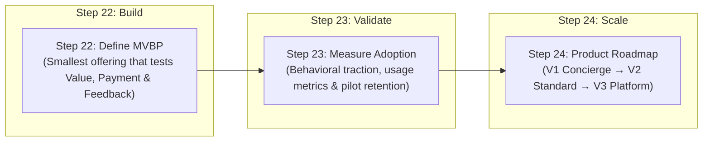
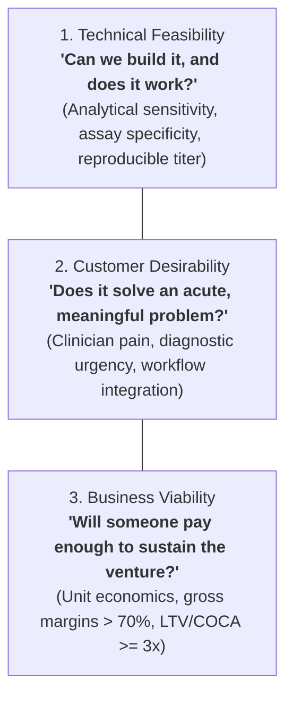
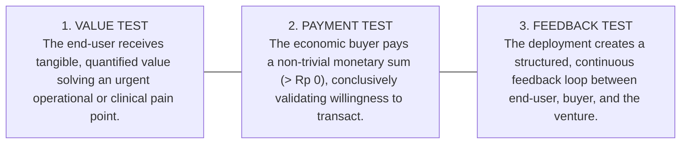
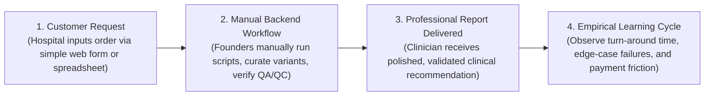
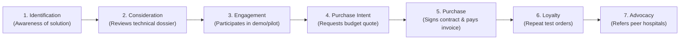
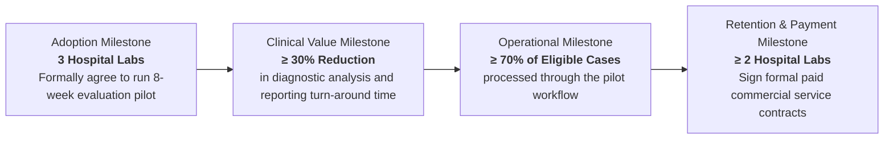
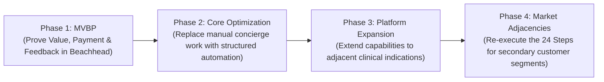
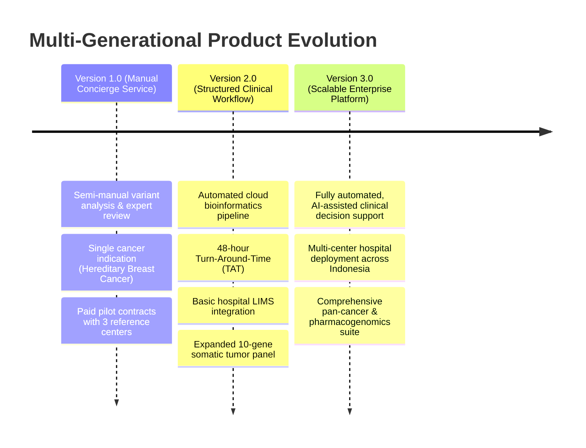
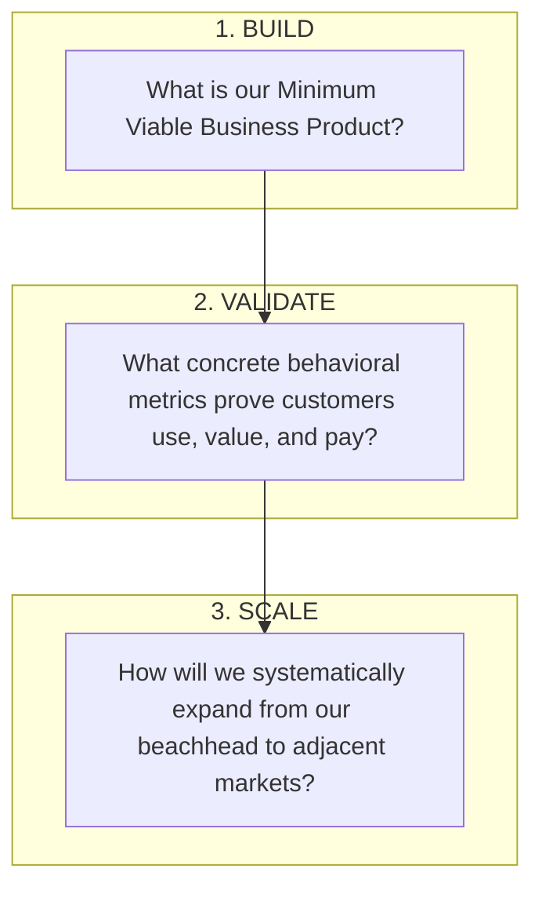

# Minimum Viable Business Product (MVBP), Customer Adoption & Product Plan
**Program:** GENOHACK 2026 Bootcamp — Day 5  
**Speaker:** Shelly Natalia (Experienced Finance & Commercial Professional, MIT Sloan Fellow / Alumna)  
**Date & Time:** Wednesday, 21 October 2026 · 19:10 – 20:50 WIB · Online  
**Theme:** Theme 5 — Product & Adoption (Disciplined Entrepreneurship Steps 22, 23, and 24)  
**Total Slides:** 21  

---

## Executive Summary & Core Philosophy

This module addresses the final triumvirate of Bill Aulet's **Disciplined Entrepreneurship (Steps 22 through 24)**. The central premise is uncompromising: **"Great technology does not automatically create a great business."**

In genomics, biotechnology, and deep-tech, academic founders frequently fall into the trap of confusing an impressive laboratory prototype (Proof of Concept / PoC) with a viable commercial product. Step 22 defines the **Minimum Viable Business Product (MVBP)**, Step 23 establishes empirical behavioral metrics to **prove customer adoption ("Show that the dogs will eat the dog food")**, and Step 24 constructs a multi-generational **Product Roadmap** to scale beyond the initial beachhead.



---

## Slide-by-Slide Detailed Transcript

### Slide 1: Cover Slide
* **Title:** GENOHACK 2026 · BOOTCAMP: MVBP, Adoption & Product Plan
* **Subtitle:** Disciplined Entrepreneurship Steps 22–24
* **Date & Schedule:** 21 October 2026 · 19:10 – 20:50 WIB · Online
* **Speaker:** Shelly Natalia (Experienced Finance & Commercial Professional, MIT)

---

### Slide 2: The Three Dimensions of Deep-Tech Success
Scientific breakthroughs and commercial enterprises require fundamentally different evidentiary standards:



> **Guiding Principle:** Innovation creates scientific potential; customer adoption and commercial transactions determine enterprise reality.

---

### Slide 3: The Final Three Steps: Build $
ightarrow$ Validate $
ightarrow$ Scale
* **BUILD (Step 22):** Minimum Viable Business Product (MVBP) — Designing the smallest functional system that tests the integrated commercial model.
* **VALIDATE (Step 23):** Real customer adoption and financial transactions — Gathering quantitative proof that customers use, value, and pay for the product.
* **SCALE (Step 24):** Product evolution and market expansion — Systematically engineering the transition from manual pilot services to automated multi-site enterprise platforms.

---

### Slide 4: Step 22 — Prototype $
eq$ MVBP
A prototype proves what you can build in the laboratory. An MVBP tests whether paying customers will adopt your offering in the real world:

| Evaluation Dimension | Laboratory Prototype / Proof of Concept (PoC) | Minimum Viable Business Product (MVBP) |
| :--- | :--- | :--- |
| **Core Objective** | Tests **Technical Feasibility** | Tests the **Integrated Business System** |
| **Operational Questions** | • Can the assay detect the target mutant allele?<br/>• Can we generate the expected analytical signal?<br/>• Can the raw laboratory workflow be demonstrated?<br/>• Can core technical uncertainties be reduced? | • Does the end user experience quantified clinical value?<br/>• Does the economic buyer pay real money ($> 0$)?<br/>• Does the interaction establish a real-world feedback loop? |
| **Commercial Reality** | A prototype holds scientific value even if **nobody is ready or willing to pay for it yet**. | An MVBP must be sufficient to validate a viable commercial offering under market conditions. |

> **Rule of Thumb:** "Don't just build a product that works technically. Build a product that can become an enduring business."

---

### Slide 5: The Three Non-Negotiable Tests of an MVBP
An offering qualifies as an MVBP if and only if it satisfies all three conditions simultaneously:



*Note: A technically flawless live demo delivered for free without customer feedback is merely a showcase — it is not an MVBP.*

---

### Slide 6: Defining the Minimum Product
Start from the comprehensive High-Level Product Specification (Step 7), then **ruthlessly eliminate** any feature that is not strictly required to prove value, payment, or feedback:

* **Must-Have Core:** Without this feature, the customer cannot receive the primary clinical/economic value. (Retain).
* **Evidence Required:** What essential analytical validation data must the customer see to trust the product? (Include).
* **Deferred Nice-to-Haves:** Advanced automated dashboards, secondary integrations, mobile notifications, polished industrial enclosures. (Cut from MVBP).

---

### Slide 7: Strategic Execution: Build, Buy, Partner, or Concierge?
Founders must resist the temptation to build every technical layer from scratch:

```mermaid
quadrantChart
    title Resource Allocation Framework for MVBP
    x-axis Commodity Capability --> Proprietary Differentiation
    y-axis High Technical Risk --> Low Technical Risk
    quadrant-1 BUILD (Proprietary Core)
    quadrant-2 PARTNER (Specialized Infrastructure)
    quadrant-3 BUY (Off-the-Shelf Standards)
    quadrant-4 CONCIERGE (Manual Pre-Automation)
    "Proprietary Bioinformatic Algorithm": [0.85, 0.85]
    "Wet-Lab Next-Gen Sequencing Runs": [0.35, 0.80]
    "Cloud Servers & LIMS Databases": [0.15, 0.20]
    "Expert Variant Annotation & Reporting": [0.80, 0.25]
```

1. **BUILD:** Proprietary technology and algorithms that establish your intellectual property moat and competitive Core.
2. **BUY:** Standard off-the-shelf reagents, generic consumables, cloud compute, and enterprise software tools.
3. **PARTNER:** Certified reference laboratories, sequencing facilities, hospital biobanks, and logistics couriers.
4. **CONCIERGE:** Manually executing complex backend tasks behind the scenes before writing expensive automation code.

---

### Slide 8: The Concierge Strategy: "Concierge Before You Automate"
In deep-tech, developing automated end-to-end software or robotic manufacturing can take years and millions of dollars. The **Concierge (Wizard of Oz)** approach allows startups to validate customer value immediately:



> **Insight:** The goal is not to hide manual labor permanently, but to postpone capital-intensive automation until customer demand, clinical edge cases, and workflow integration are thoroughly understood.

---

### Slide 9: Case Study — A Genomic Service MVBP
* **Target User:** Hospital pathology laboratory or specialized clinical oncology team requiring rapid genomic interpretations.
* **MVBP Architecture:** Sample-to-report concierge service. Samples are sequenced via an outsourced partner lab; bioinformatics curation and clinical reporting are executed semi-manually by the founders.
* **Commercial Payment:** Billed on a transactional per-completed-analysis invoice (proving willingness to pay).
* **Feedback Mechanism:** Bi-weekly clinical review calls with attending oncologists to refine report formatting, variant ambiguity, and decision utility.

---

### Slide 10: Action Worksheet: Designing Your MVBP
Teams must formulate their MVBP specifications across five core pillars:

```markdown
1. TARGET CUSTOMER & ECONOMIC BUYER:
   - Primary End User: _____________________________________________
   - True Economic Buyer: __________________________________________

2. CRITICAL CUSTOMER PROBLEM:
   - The single most painful bottleneck we are eliminating:
     _______________________________________________________________

3. THREE ESSENTIAL PRODUCT CAPABILITIES (Non-Negotiable):
   - Capability 1: _________________________________________________
   - Capability 2: _________________________________________________
   - Capability 3: _________________________________________________

4. CONCIERGE & DEFERRED ELEMENTS:
   - What will be executed manually behind the scenes? ______________
   - What will be outsourced to certified partners? _________________
   - What complex features are explicitly deferred to V2? ___________

5. PAYMENT & VALUE HYPOTHESIS:
   - [Target Customer] will pay [Price & Unit] for our MVBP because
     it delivers [Quantified Operational / Clinical Value].
```

---

### Slide 11: Step 23 — Adoption = Behavior, Not Interest ("The Dogs Will Eat the Dog Food")
Customer compliments, polite encouragement, and academic enthusiasm are not evidence of traction. **Only measurable customer behavior proves adoption.**



---

### Slide 12: What to Measure: The 4 Quadrants of Traction
Founders must establish quantitative success thresholds *before* launching the pilot:

| Metric Category | Operational Definition & Life Sciences Scope |
| :--- | :--- |
| **1. Usage Metrics** | Active test runs, sample completion rate, repeat weekly orders, hands-on time required in lab, assay failure/re-run rate. |
| **2. Commercial Metrics** | Lead-to-customer conversion velocity, payment collection speed, discounting requested, procurement cycle length. |
| **3. Retention Metrics** | Contract renewal rates, repeat reagent kit reorders, net account churn, clinical advocacy / peer referrals, technical support burden. |
| **4. Economic Metrics** | Gross margin per test run, realized LTV, empirical COCA, direct marginal service cost per patient report. |

---

### Slide 13: Genomics-Specific Adoption Metrics Matrix

| Evaluation Dimension | Track 1: Precision Diagnostics | Track 2: Research & Analytics Platforms | Track 3: Food Security & Biodiversity |
| :--- | :--- | :--- | :--- |
| **Technical Performance** | Analytical sensitivity & specificity; Turn-Around-Time (TAT); sample rejection rate. | Algorithm accuracy; compute runtime per genome; manual variant review rate. | Pathogen detection limit; assay reproducibility in field; sampling effort required. |
| **Workflow Adoption** | % of clinical reports reviewed by oncologist; order-to-result clinical TAT. | Daily active bioinformaticians; total completed pipeline runs per week. | On-site testing duration; compatibility with farm harvest cycles. |
| **Commercial Traction** | Number of paid clinical test runs; repeat diagnostic test reorders. | Paid enterprise software seats; annual institutional renewals. | Number of commercial ponds/hectares contracted; repeat seasonal monitoring contracts. |
| **Demonstrated Value** | Documented therapeutic changes; avoided invasive repeat biopsies. | Clinician research hours saved; novel biomarker discoveries achieved. | Avoided crop/aquaculture disease losses; net cost savings per production site. |

---

### Slide 14: Case Study — GeneFlow's 8-Week Customer Pilot
GeneFlow, an early-stage clinical genomics venture, structured an 8-week pilot with three private hospital laboratories:



> **Key Lesson:** Predefining quantitative pass/fail criteria prevents the team from lingering in endless "free trial" limbo.

---

### Slide 15: Diagnostic Protocol: What If Customers Don't Adopt?
Negative evidence is highly valuable when it uncovers the exact failure mode of the business model:

| Observed Symptom | Underlying Commercial Root Cause | Corrective Strategic Intervention |
| :--- | :--- | :--- |
| **Low Initial Customer Interest** | Misalignment with primary clinical pain. | Re-interview Personas; pivot value proposition from academic interest to urgent clinical/financial ROI. |
| **Trial Initiated, but Zero Usage** | Excessive workflow friction or technical complexity. | Re-evaluate lab SOP integration; deploy dedicated concierge support to remove technical hurdles. |
| **High Usage, but Refusal to Pay** | Target user lacks budget authority, or pricing model is incompatible with institutional reimbursement. | Shift sales outreach to the true Economic Buyer (Hospital Director / Program Owner); pivot pricing to OpEx billing codes. |
| **Payment Completed, but Zero Retention** | Value was temporary or non-reproducible; high ongoing operational burden. | Investigate post-pilot quality drops; establish a dedicated Customer Success & Quality Assurance protocol. |

---

### Slide 16: Step 24 — Develop the Product Plan
The Product Plan defines how the venture evolves beyond the initial beachhead MVBP without prematurely over-engineering features:



*Parallel Scaling Tracks:* Throughout this product roadmap, the venture must concurrently advance **Regulatory Approvals (Kemenkes/BPOM)**, **Quality Management Systems (ISO 13485/CPOB)**, **Distribution Channels**, and **Working Capital**.

---

### Slide 17: Example — Genomics Venture Product Roadmap



---

### Slide 18: Strategic Prioritization Framework for Roadmap Features
Every prospective feature competes for scarce engineering bandwidth and venture capital. Prioritize using six criteria:

1. **Customer Benefit:** Does this feature materially amplify clinical accuracy, speed, or cost savings?
2. **Core Leverage:** Does it deepen your technical moat (e.g., proprietary Asian genomic database)?
3. **Internal Resources:** Does the team possess the bioinformatics, wet-lab, or regulatory talent to build and support it?
4. **Implementation Risk:** What new scientific, regulatory, or operational uncertainties does this feature introduce?
5. **Commercial Reward:** What new revenue streams, margin expansion, or customer segments does it unlock?
6. **Market Timing:** Is this the right sequential time, or does it prematurely distract from beachhead domination?

---

### Slide 19: The Execution Summary: Build Small $
ightarrow$ Prove Value $
ightarrow$ Scale What Works



---

### Slide 20: Four Key Takeaways
1. **Build the Smallest Product That Proves Business Viability:** Deliver authentic customer value, validate willingness to transact, and establish a permanent feedback loop.
2. **Start Simple, Learn Fast, Automate Later:** Harness concierge services, manual workflows, and trusted laboratory partners to validate demand before investing millions in automated robotics.
3. **Prove Adoption Through Actions, Not Politeness:** Track objective behavioral conversions, actual usage hours, payment transactions, and unprompted renewals.
4. **Scale What Works Guided by Customer Evidence:** Evolve the product roadmap deliberately to reinforce your Core moat and expand into adjacent clinical markets.

---

### Slide 21: Closing Manifesto
> **"Great science creates possibilities.**  
> **Customer validation builds businesses.**  
> **Disciplined execution enables scale."**
