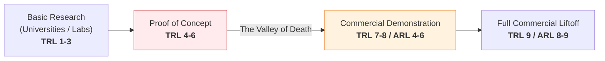
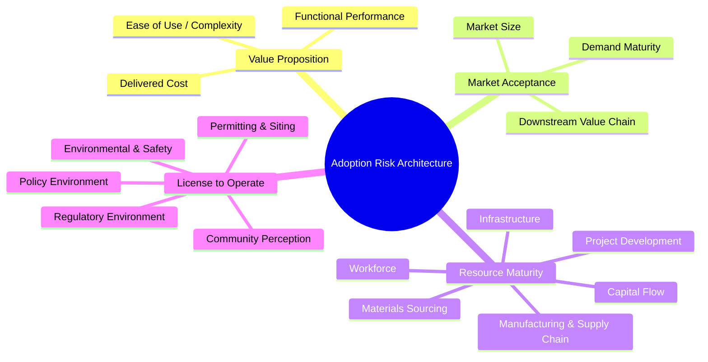

# Adoption Readiness Levels (ARLs) 101: A Framework for Commercial Liftoff
**Source Document:** US Department of Energy (DOE) Office of Technology Transitions (OTT)  
**Collaborators:** Office of Clean Energy Demonstrations (OCED) & Advanced Research Projects Agency - Energy (ARPA-E)  
**Context:** Reference Framework for GENOHACK 2026 Bootcamp Day 6 (Commercial Adoption & Liftoff)  
**Total Slides:** 33  

---

## Executive Summary & Institutional Context

For decades, the global scientific and engineering community has relied on NASA's **Technology Readiness Levels (TRL 1–9)** to evaluate research and development. However, governments, venture capital firms, and deep-tech incubators have repeatedly witnessed a catastrophic systemic failure: **technologies achieving TRL 8 or 9 (proven in operational environments) still fail to achieve commercial adoption, stalling in the "Commercialization Valley of Death."**

TRL evaluates whether an engineered system works technically; it **fails completely to measure whether the market, regulatory environment, supply chain, and capital markets will adopt it.**

To solve this gap, the US Department of Energy's **Office of Technology Transitions (DOE OTT)**, in collaboration with **OCED** and **ARPA-E**, developed the **Adoption Readiness Level (ARL 1–9)** framework. ARL complements TRL by evaluating non-technical barriers across 17 empirical dimensions spanning four pillars: **Value Proposition, Market Acceptance, Resource Maturity, and License to Operate.**

```mermaid
flowchart TD
    subgraph The Commercialization Continuum (RDD&D)
        R["1. Research<br/>(Fundamental Science)"] --> D1["2. Development<br/>(Engineering Prototypes)"]
        D1 --> D2["3. Demonstration<br/>(Pilot & Commercial Scale)"]
        D2 --> D3["4. Deployment<br/>(Full Market Liftoff)"]
    end
    subgraph Dual-Axis Portfolio Management
        T["Technology Readiness (TRL 1–9)<br/><i>'Does it work technically?'</i>"]
        A["Adoption Readiness (ARL 1–9)<br/><i>'Will the ecosystem adopt it?'</i>"]
    end
    R & D1 -.-> T
    D2 & D3 -.-> A
```

---

## Slide-by-Slide Detailed Transcript

### Slide 1: Cover Slide
* **Title:** Using Adoption Readiness Levels (ARLs)
* **Subtitle:** A Framework to Guide and Evaluate Commercial Liftoff
* **Publishing Body:** Office of Technology Transitions (OTT), U.S. Department of Energy (DOE)
* **Program:** ARL 101 Masterclass

---

### Slide 2: Commercialization Background & Mandate
* **Mission of DOE OTT:** Expand the commercial and societal impact of the Department of Energy's multi-billion dollar research, development, demonstration, and deployment (RDD&D) portfolio.
* **The Commercialization Challenge:** Commercial liftoff requires intentional, synchronized coordination between public sector investments, private sector capital, corporate off-takers, supply chain manufacturers, and regulatory bodies.

---

### Slide 3: Section Divider — Commercialization Background
*(Visual transition slide demarcating the shift from technology push to market pull).*

---

### Slide 4: Maximizing Commercial Impact of Public & Private R&D
* Moving technologies across the RDD&D continuum requires that laboratory and academic research be conducted **with the target commercial end-market in mind from Day One**.
* Stage-gating technology development solely through technical milestones leads to stranded assets that are functionally impressive but economically unviable.

---

### Slide 5: The Limitations of Technology Readiness Levels (TRL)
* **Origins of TRL:** Formulated by NASA in the 1970s and 1980s (Mankins, 1995) to manage aerospace component risk for space missions where NASA was the sole customer and funder.
* **The TRL Spectrum (1 to 9):**
  * TRL 1–3: Basic principles observed $
ightarrow$ Technology concept formulated $
ightarrow$ Experimental proof of concept.
  * TRL 4–6: Component validation in lab $
ightarrow$ System validation in relevant environment $
ightarrow$ System prototype demonstration.
  * TRL 7–9: System prototype in operational environment $
ightarrow$ System complete and qualified $
ightarrow$ Actual system proven in operational mission.

---

### Slide 6: The Commercialization "Valley of Death"
In commercial markets, unlike space exploration, the developer is not the sole customer:



> **The Core Problem:** The "Valley of Death" occurs between TRL 6 and TRL 9, where public research grants expire, but private debt and equity investors refuse to commit capital due to unquantified market, regulatory, and supply chain adoption risks.

---

### Slide 7: Why TRL Fails to Capture Essential Adoption Factors
TRL answers: *"Does the technology function as an engineered mechanism?"*  
TRL **fails** to answer:
1. Is the delivered cost competitive against entrenched incumbent solutions?
2. Does the downstream supply chain exist to manufacture replacement parts at scale?
3. Are commercial banks willing to underwrite project finance debt?
4. Do local communities and municipal regulators allow permits to construct facilities?
5. Does the solution require customers to overhaul their entire standard operating procedure?

---

### Slide 8: Section Divider — Introducing Adoption Readiness Levels (ARL)
*(Visual transition slide introducing the 17-dimension adoption risk architecture).*

---

### Slide 9: Augmenting TRL with ARL for Holistic Portfolio Governance
ARLs are designed to operate alongside TRLs to provide a 2D matrix of venture readiness:

```mermaid
quadrantChart
    title Dual-Axis TRL vs. ARL Portfolio Governance
    x-axis Low Adoption Readiness (ARL 1-3) --> High Adoption Readiness (ARL 7-9)
    y-axis Low Technical Readiness (TRL 1-3) --> High Technical Readiness (TRL 7-9)
    quadrant-1 Commercial Liftoff (TRL 9, ARL 9)
    quadrant-2 Tech-Heavy Trap (High TRL, Low ARL)
    quadrant-3 Early Research (Low TRL, Low ARL)
    quadrant-4 Premature Commercialization (Low TRL, High ARL)
    "Venture Target": [0.85, 0.85]
    "Academic Trap": [0.20, 0.85]
    "Status Quo Research": [0.25, 0.25]
```

---

### Slide 10: Value Case & ARPA-E Integration
* **ARPA-E's "Tech-to-Market" (T2M) Practice:** ARPA-E program directors utilize ARL metrics to set commercialization milestones alongside technical milestones in research contracts.
* **Benefits for Project Leaders:**
  * Translates abstract commercialization hurdles into concrete, actionable engineering targets.
  * Directs non-dilutive grant funds toward de-risking the specific adoption bottleneck (e.g., supply chain sourcing rather than extra decimal places of laboratory precision).

---

### Slide 11: Section Divider — Institutional Adoption & Case Studies
*(Visual transition slide showcasing deployments across federal and commercial programs).*

---

### Slide 12: ARL Integration into OCED (Office of Clean Energy Demonstrations)
* OCED manages over **$25 Billion** in commercial demonstration funding (Regional Clean Hydrogen Hubs, Direct Air Capture, Industrial Decarbonization).
* ARL serves as a foundational evaluation criterion in funding opportunity announcements (FOAs), ensuring multi-hundred-million-dollar federal demonstration awards are granted only to consortia with credible adoption liftoff pathways.

---

### Slide 13: Section Divider — Adoption Risk Dimensions
*(Visual transition slide introducing the 4 core categories).*

---

### Slide 14: Industry & Stakeholder Feedback on ARL
* *"The ARL / CARAT rubric is brilliant and is exactly what we have been missing to structure conversations with private equity and infrastructure lenders."* — Clean Energy Venture Executive.

---

### Slide 15: Section Divider — ARL Assessment Methodology
*(Visual transition slide detailing the qualitative, fact-based scoring process).*

---

### Slide 16–21: The 4 Categories & 17 Dimensions of Adoption Risk



#### Detailed Breakdown of the 17 Dimensions (Slides 16–21)

| Category | # | Dimension Name | Core Operational Scope & Evaluation Focus |
| :--- | :-: | :--- | :--- |
| **A. Value Proposition** | 1 | **Delivered Cost** | Cost competitiveness when produced at full commercial scale (including capex amortization and switching costs) vs. incumbent solutions. |
| | 2 | **Functional Performance** | Meeting or exceeding incumbent performance parameters; defensibility of competitive advantage (IP protection). |
| | 3 | **Ease of Use / Complexity** | Operational switching friction; ability of customer personnel to adopt with limited retraining; plug-and-play interoperability. |
| **B. Market Acceptance** | 4 | **Demand Maturity / Market Openness** | Customer demand certainty; existence of transparent contracting/off-take norms; absence of structural monopoly lock-in. |
| | 5 | **Market Size** | Sizing and certainty of the Total Addressable Market that can be served by the technology solution. |
| | 6 | **Downstream Value Chain** | Physical and logistical path to deliver the product from manufacturing plant to end-user (distributors, cold-chain, logistics). |
| **C. Resource Maturity** | 7 | **Capital Flow** | Availability of commercial debt and equity financing; willingness of conservative commercial banks and underwriters to fund projects. |
| | 8 | **Project Development & Management**| Standardized engineering, procurement, and construction (EPC) capabilities to execute deployments repeatedly on time and budget. |
| | 9 | **Infrastructure** | Large-scale external systems required to enable deployment (high-voltage transmission, pipelines, specialized clinical waste disposal). |
| | 10| **Manufacturing & Supply Chain** | Industrial availability of specialized component fabricators, CMOs, and system integrators. |
| | 11| **Materials Sourcing** | Secure, ethical, and price-stable supply of critical raw materials (rare earth elements, specialized enzymes, pure chemicals). |
| | 12| **Workforce** | Availability of certified human talent (specialized technicians, clinical operators, bioinformaticians) to operate systems at scale. |
| **D. License to Operate** | 13| **Regulatory Environment** | Clear, predictable regulatory clearance pathways (BPOM, Kemenkes, FDA, EPA) without indefinite administrative delays. |
| | 14| **Policy Environment** | Alignment with national legislation, government tax credits, import tariffs, or subsidy phase-outs. |
| | 15| **Permitting & Siting** | Speed, transparency, and repeatability of securing environmental, municipal, and zoning permits across jurisdictions. |
| | 16| **Environmental & Safety** | Inherent hazardous side effects, toxicity, carbon footprint, biohazard containment, or catastrophic failure modes. |
| | 17| **Community Perception** | Social license to operate; public acceptance vs. localized resistance (NIMBYism, GMO skepticism, genetic privacy fears). |

---

### Slide 22: Historical Case Study — Utility Solar PV (2009–2011 vs. 2016)
Demonstrating how ARL risks evolve over time using utility-scale solar photovoltaics as a benchmark:

* **Starting Baseline (2009–2011):**
  * *TRL Status:* **TRL 8–9** (Solar panels functioned reliably in field installations).
  * *Delivered Cost Risk:* **HIGH** — Levelized Cost of Electricity (LCOE) was uncompetitive against coal and gas without massive subsidies.
  * *Functional Performance Risk:* **HIGH** — Intermittency and grid stability concerns raised doubts among utility grid operators.
  * *Capital Flow Risk:* **HIGH** — Commercial banks viewed utility-scale solar as an uninsurable technology risk and refused non-recourse debt financing.
* **Targeted Interventions (DOE SunShot & Loan Programs Office):**
  * DOE Loan Guarantee Program financed the first 5 utility-scale PV projects $>100	ext{ MW}$, proving bankability.
  * Module manufacturing scale and balance-of-system innovations drove capital costs down by $>70\%$.
* **Market Maturation (By 2016):**
  * *Delivered Cost Risk:* **LOW** — Utility solar became the lowest-cost source of new electricity generation in multiple regions.
  * *Functional Performance Risk:* **LOW** — Advanced inverters and paired battery storage mitigated intermittency.
  * *Capital Flow Risk:* **LOW** — Institutional capital flooded the sector; utility solar became an established, commoditized infrastructure asset class.

---

### Slide 23: From Qualitative Dimensions to Numerical ARL Score
* The ARL assessment identifies and prioritizes the exact gating barriers to commercial liftoff.
* A numerical score from **ARL 1 to ARL 9** is derived by aggregating the qualitative assessments across the 17 risk dimensions.
* Provides a common vocabulary bridging engineers, corporate buyers, regulators, and venture investors.

---

### Slide 24–26: The Commercial Adoption Readiness Assessment Tool (CARAT)
* **CARAT** is the publicly available, open-source tool developed by DOE OTT to operationalize the ARL framework.
* Features standardized qualitative scoring rubrics (Low, Medium, High risk) and an automated look-up matrix that outputs an objective ARL score.

---

### Slide 27: Driving Project Management & Milestone Gating
For startup founders and project managers, the ARL assessment drives:
1. **De-risking Prioritization:** Identifies which non-technical hurdles will stall the next funding round.
2. **Resource Allocation:** Prevents over-investing in micro-optimizing laboratory yields when the primary barrier is a missing regulatory standard or absent distributor network.
3. **Structured Milestone Contracts:** Ties tranches of capital to achieving specific adoption milestones (e.g., signing a pilot off-take agreement or securing a zoning permit).

---

### Slide 28–29: Portfolio-Level Governance for Funders & Accelerators
* Program managers can view their entire cohort of ventures across the **TRL vs. ARL matrix**.
* Uncovers systemic cohort bottlenecks: for instance, if 80% of genomics ventures have high TRL but fail on *Regulatory Environment* and *Capital Flow*, the accelerator can organize targeted regulatory sandbox dialogues with the Ministry of Health.

---

### Slide 30–33: Summary & Next Steps
* Commercial liftoff requires equal rigor applied to technology readiness (TRL) and adoption readiness (ARL).
* Deep-tech ventures that systematically de-risk all 17 ARL dimensions cross the "Valley of Death" to achieve enduring commercial scale.
