# GENOHACK 2026 — Pitch Guidelines
## Master Pitch Deck Structure & Demo Day Presentation Playbook

- **Event:** GENOHACK Hackathon ITB Series (Deeptech Genomik 2026)
- **Date:** 25 October 2026
- **Source File:** `Hackathon/GENOHACK 2026 — Pitch Guidelines.pdf`
- **Organizers & Ecosystem Partners:**
  - *Organizers:* ITB (SITH, SF, SBM), SoluSEA Venture Labs, synbio.id, GENEPICA
  - *Institutional Supporters:* DHKT, LPDP, Ditjen Risbang, Diktisaintek Berdampak
  - *Industry Partners:* Biofarma, PathGen Diagnostik Teknologi
  - *Ecosystem & Venture Partners:* AIS, B71 (An NUSX Venture Platform), Innovation Factory, Garuda Spark Bandung
  - *Media Partner:* Beyond Innovation Center

---

## Pitch Narrative Overview

The pitch deck represents a coherent storyline combining deeptech innovation, quantified customer value, and a rigorous path to market. 
- Teams do **not** need one slide per heading; combine sections where it improves narrative clarity.
- Focus on clarity, visual evidence, validated assumptions, and concrete numbers rather than generic statements.

```mermaid
flowchart LR
    A["1. Intro & Hook"] --> B["2. Story & Urgency"]
    B --> C["3. Target Customer & Pain"]
    C --> D["4. Solution & Demo"]
    D --> E["5. TAM & Unit ROI"]
    E --> F["6. Competitive Advantage"]
    F --> G["7. GTM & Business Model"]
    G --> H["8. Financials & Drivers"]
    H --> I["9. Team Credibility"]
    I --> J["10. Summary & Ask"]
```

---

## Detailed Section-by-Section Structure

### 1. INTRO
- **Team / Product Name:** Clear brand identity and track identification.
- **Compelling Tagline:** High-impact phrase focused directly on the tangible benefits.
- **Visual Impact:** Clean, professional visual representing the deeptech / genomics concept.
- **Audience Takeaway:** The single dominant message the judges and investors must remember.
- **The Initial Hook:** Briefly foreshadow the ask and company vision.

### 2. STORY / MAKE A CONNECTION
- **Tell a Concrete Story:** Anchor the presentation in a real-world scenario or clinical case.
- **User / Buyer Persona:** Introduce the specific human actor experiencing the problem (e.g., oncologist, lab director, patient).
- **As-Is State:** The painful, inefficient, or flawed status quo.
- **Urgency:** Why this problem cannot wait (e.g., mortality rates, regulatory shifts, cost escalation).
- **Desired State:** How the world looks once your solution is deployed.

### 3. TARGET CUSTOMER / PAIN POINT
- **Who Exactly is the Target Customer / User?** Clearly delineate between the End User (who operates the tool) and the Economic Buyer (who signs the check).
- **Why is This Painful / Important?** Quantify the pain (time lost, diagnostic errors, therapy failures, financial penalties).
- **Why Now?** Market catalysts (e.g., emergence of precision oncology, genomics democratization, national health policies).
- **Who Pays?** Explicitly state the payment mechanism (out-of-pocket, BPJS, hospital OPEX, private insurance).
- **Use Specific Examples:** Ground the discussion with actual workflow data.
- **Name Your First 10 Customers / Target Organizations:** Concrete pipeline of hospitals, research institutes, diagnostic labs, or pharmaceutical partners.

### 4. SOLUTION & DEMO
- **Show, Do Not Only Describe:** Display screenshots, mockups, prototype data, or workflow diagrams.
- **Use Visuals:** Flowcharts, user interfaces, or assay architectures.
- **Quantify the Benefit:** State exact improvements (e.g., "70% lower turnaround time", "85% reduction in reagent cost", "92% clinical concordance").
- **Demonstrate the Product / Prototype:** Provide visual proof of technical feasibility and analytical validity.

### 5. TOTAL ADDRESSABLE MARKET (TAM) & ROI
- **Show the Math:** Never just quote a generic global market research report.
- **Prefer Bottom-Up Logic:**
  $$	ext{TAM} = (	ext{Number of Potential Customers / Patients}) 	imes (	ext{Annual Revenue / Price per Test})$$
- **Size Justification:** Explain why the initial beachhead and subsequent total market are large enough to build a venture-scale business.
- **Quantify Customer ROI / Economic Value:** Demonstrate why buying the solution saves money or generates positive financial return for the hospital, laboratory, or payer.

### 6. COMPETITIVE ADVANTAGE & CORE
- **Identify Major Competitors & Alternatives:** Include direct competitors, indirect workarounds, and the formidable option of "Doing Nothing" (the status quo).
- **Meaningful Differentiation:** What makes you 10x better, faster, cheaper, or uniquely tailored to the regional demographic?
- **Competitive Positioning Chart (2x2 Matrix):** Plot the market on two critical, customer-centric axes that emphasize your unique positioning.
- **Defensibility & Core:** Link your advantage to an asset that is difficult to replicate (proprietary datasets, regulatory exclusivity, deep clinical partnerships, patent/IP).

### 7. GO-TO-MARKET (GTM) STRATEGY, BUSINESS MODEL & BUYING PROCESS
- **Target Buyer Archetype:** Who do you sell to (B2B, B2G, B2B2C)?
- **Decision-Making Unit (DMU):**
  - Who uses the product? (End User)
  - Who champions it internally? (Champion)
  - Who approves the budget? (Economic Buyer)
  - Who can veto or delay the purchase? (Veto power / Regulatory / Compliance)
- **Customer "Watering Holes":** Professional conferences, oncological societies, lab director forums, or hospital consortia where target customers congregate.
- **Customer Acquisition Strategy:** How you convert leads from initial awareness to trial and contracted sales.
- **Business Model:** Reagent rental, kit sales, software-as-a-service (SaaS) per report, or fee-per-sample.
- **The Buying Process:** Step-by-step path from awareness, technical validation, tender/procurement, to repeat recurring ordering.

### 8. FINANCIALS & UNIT ECONOMICS
- **Keep It Simple & Realistic:** Avoid overly complex 20-row tables; focus on the primary economic engine.
- **Top-Line Growth Projection:** 3-to-5 year trajectory depicted in a clear visual graph.
- **Key Operational Drivers:** Number of units sold, average selling price (ASP), COGS, gross margin, key developmental milestones.
- **Value Estimate & Pricing Strategy:** How your pricing captures a fair fraction of the economic value created.
- **Critical Assumptions:** Disclose and justify the most sensitive assumptions (adoption rate, assay batching, consumable pricing).

### 9. TEAM & EXECUTION CAPABILITY
- **Why are YOU the Team to Solve This?** Highlight domain expertise in genomics, bioinformatics, oncology, and commercialization.
- **Relevant Roles and Qualifications:** Technical leads, scientific advisors, and business operators.
- **Curated Credentials:** Include only qualifications that directly reinforce execution credibility.
- **Capability Roadmap:** What key hires or advisory competencies are needed in the next 6-12 months.

### 10. SUMMARY & THE ASK
- **Rule of Three:** Reiterate the 3 most crucial points the judges must remember.
- **Clear Call to Action (CTA):** State clearly what follows this presentation.
- **Specific Ask:**
  - Funding amount requested (or prize allocation).
  - Use of funds (milestone-based: R&D, clinical validation, regulatory filing, commercial pilot).
  - Non-monetary asks (hospital partnership introductions, pilot trial access, regulatory mentorship).
- **Closing:** End with confidence, professional clarity, and conviction.

---

## Recommended Additional Resources

- **Y Combinator Guide to Demo Day Pitches:**  
  [https://www.ycombinator.com/blog/guide-to-demo-day-pitches/](https://www.ycombinator.com/blog/guide-to-demo-day-pitches/)
- **Y Combinator Pitch Deck Library & Video:**  
  *Kevin Hale – How to Pitch Your Startup*  
  [https://www.ycombinator.com/library/4T-how-to-design-a-better-pitch-deck](https://www.ycombinator.com/library/4T-how-to-design-a-better-pitch-deck)
- **Reference Deeptech Pitch:**  
  *LymeAlert delta v Demo Day Pitch* (6 September 2024, MIT delta v accelerator).
