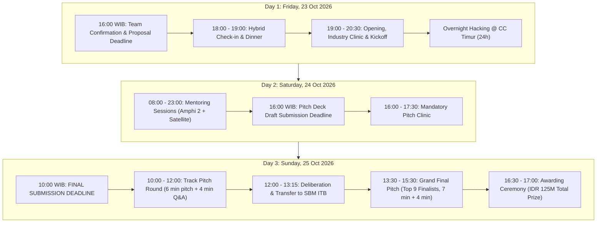
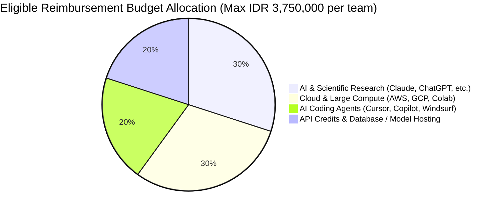
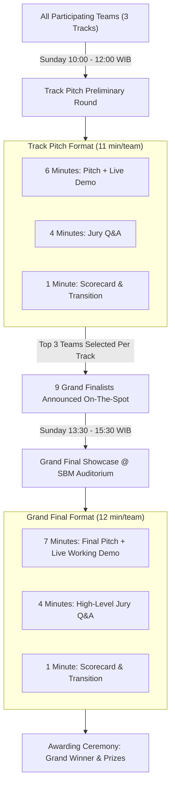
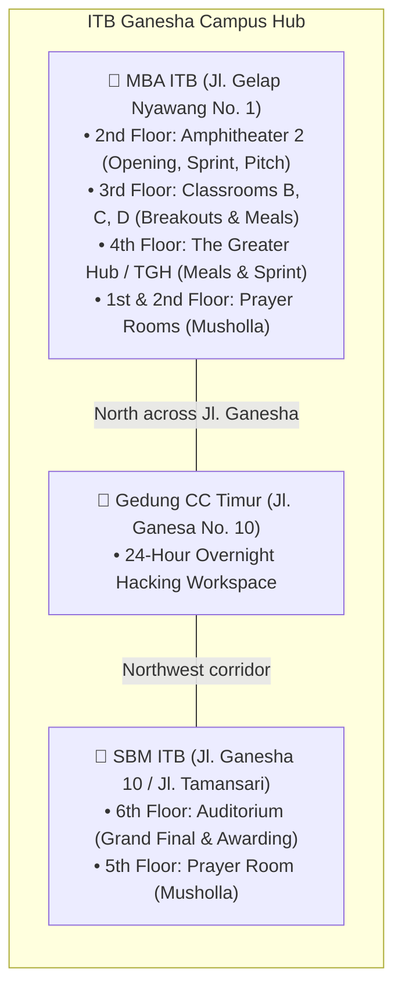

# GENOHACK 2026 — Hackathon Participant Guide
## Official Operational Playbook, Schedules, Rules, Reimbursement, and Mentorship Directory

- **Event:** Hackathon ITB Series 2026: GenoHack — Hackathon Deeptech Genomik 2026
- **Program Dates:** 23–25 October 2026
- **Source File:** `Hackathon/GENOHACK 2026 — Hackathon Participant Guide.pdf` (15 Pages)
- **Host Institutions & Organizers:**
  - *Academic Hosts:* Institut Teknologi Bandung (ITB 1920) — SITH ITB (Sekolah Ilmu dan Teknologi Hayati), SF ITB (Sekolah Farmasi), SBM ITB (School of Business & Management)
  - *Incubator & Program Organizers:* SoluSEA Venture Labs, synbio.id, GENEPICA
  - *Governmental & University Sponsors:* DHKT ITB (Direktorat Hubungan Komunikasi dan Transformasi), Kemendikbudristek (Tut Wuri Handayani), LPDP (Lembaga Pengelola Dana Pendidikan), Ditjen Risbang (Direktorat Jenderal Riset dan Pengembangan), DIKTISAINTEK BERDAMPAK
  - *Industry Partners:* PT Bio Farma (Persero) (Member of Biofarma Group), PT PathGen Diagnostik Teknologi
  - *Ecosystem & Venture Partners:* AIS (Massachusetts Institute of Technology), B71 (An NUSX Venture Platform), Innovation Factory, Garuda Spark Bandung
  - *Media Partners:* Ganesha Student Innovation Center

---

## Executive Summary & Visual Architecture



---

## 1. Quick Checklist & Track Overview

### Mandatory Participant Deadlines (Friday, 23 October 2026)

> [!IMPORTANT]
> **Complete these action items before Friday, 23 October 2026 at 04:00 PM (16:00 WIB):**
> 1. **Final Team Confirmation Form:** Confirm final team composition, roster, and chosen hackathon track.
>    - Shortlink: `s.id/genohack-finalteam`
>    - Direct URL: [Google Form Team Confirmation](https://docs.google.com/forms/d/e/1FAIpQLSds6hBGwSCVt3LS69q1kHUyW0_X7OcutBLlqQS7CSPJa_gDnA/viewform?usp=publish-editor)
> 2. **Proposal & Integrity Pact Submission:** Upload team proposal and signed integrity pact in the form. The proposal is not graded for judging, but serves directly to match each team with appropriate domain mentors.
>    - Shortlink: `s.id/genohack-proposal`
>    - Direct URL: [Google Docs Template & Pact](https://docs.google.com/document/d/1iRZKtfnuolfg_WnMapkeK7z204NcsBvW/edit)
> 3. **Judging & Pitch Format Review:** Review all evaluation criteria, scoring weights, and presentation rubrics.
> 4. **Hardware Readiness:** Bring personal laptops, power adapters, chargers, extension cords, and display adapters (HDMI/USB-C).

### The Three Hackathon Tracks

| Track # | Track Name | Primary Technological & Market Focus |
| :---: | :--- | :--- |
| **Track 1** | **Precision Genomic Diagnostic** | Clinical diagnostics, liquid biopsy, oncology gene panels, rare disease screening, pharmacogenomics decision systems, molecular assays, LDT pipelines. |
| **Track 2** | **Genomics for Food Security & Biodiversity** | Agricultural genomics, crop resilience, disease resistance, livestock breeding, metagenomic soil analysis, Indonesian endemic biodiversity bio-banking and conservation. |
| **Track 3** | **Biomanufacturing & Synthetic Biology for Pharmaceuticals** | Strain engineering, microbial cell factories, recombinant therapeutic protein expression, enzyme engineering, peptide synthesis, bio-fermentation optimization, bioprocess scale-up. |

> [!WARNING]
> **Track Lock Rule:** Teams must remain within their confirmed track. No track changes are permitted during the hackathon unless explicitly approved in writing by the organizing committee prior to preliminary judging.

---

## 2. Complete 3-Day Hackathon Schedule

All times are displayed in Western Indonesia Time (WIB, UTC+7).

### Day 1: Friday, 23 October 2026

| Time (WIB) | Activity | Venue & Modality | Notes / Logistics |
| :---: | :--- | :--- | :--- |
| **16:00** | **Registration & Form Deadline** | Online | Cut-off for final team confirmation form and integrity pact. |
| **18:00 – 19:00** | **Registration & Dinner** | 📍 **Hybrid**<br>• Amphitheater 2, 2nd Floor, Gedung MBA ITB<br>• Online via Zoom | On-site team badge pick-up, networking, dinner distribution. |
| **19:00 – 19:30** | **Hackathon Opening Ceremony** | 📍 **Hybrid**<br>• Amphitheater 2, MBA ITB & Zoom | Official welcome by ITB leadership, SoluSEA, and partners. |
| **19:30 – 20:00** | **Industry Challenges & Clinic** | 📍 **Hybrid**<br>• Amphitheater 2, MBA ITB & Zoom | Problem owner clinics (Bio Farma & PathGen). Clarification of problem statements. |
| **20:00 – 20:30** | **Hackathon Kickoff** | 📍 **Hybrid**<br>• Amphitheater 2, MBA ITB & Zoom | Clock starts for the 40-hour hacking and prototyping sprint. |
| **20:30 – Onward** | **Overnight Hacking Sprint** | 📍 **CC Timur ITB** (24 Hours) | Participants transition to Gedung Campus Center Timur for overnight work. |

### Day 2: Saturday, 24 October 2026

| Time (WIB) | Activity | Venue & Modality | Notes / Logistics |
| :---: | :--- | :--- | :--- |
| **08:00 – 08:30** | **Breakfast* / Arrival** | 📍 The Greater Hub (TGH), 4th Floor, MBA ITB<br>📍 Classroom B, C, D, 3rd Floor, MBA ITB | Breakfast served. Meals strictly prohibited inside Amphitheater. |
| **08:00 – 23:00** | **Full-Day Mentoring Slots** | 📍 **Hybrid**<br>• Amphitheater 2 (2nd Floor, MBA ITB)<br>• Online via Zoom / Google Meet<br><br>**Satellite Workspaces\*:**<br>• The Greater Hub (TGH), 4th Floor, MBA ITB<br>• Classrooms B, C, and D, 3rd Floor, MBA ITB | 1-on-1 scheduled mentor office hours spanning technical, scientific, computational, clinical, regulatory, and business tracks. |
| **12:00 – 13:00** | **Lunch Break\*** | 📍 Satellite Rooms / TGH / Outdoor Courtyard | Catering provided. Cleanliness protocol strictly enforced. |
| **16:00** | **Pitch Deck Draft Submission** | Online Google Form | **Hard Deadline for Pitch Clinic review.**<br>Submission Link: [Draft Submission Form](https://docs.google.com/forms/d/e/1FAIpQLSd7kcJYKPMBmgHUc8ijNtPKvt5mhNzqq1FhQNsiskixWmJpdA/viewform?usp=publish-editor) |
| **16:00 – 17:30** | **Pitch Clinic** | 📍 **Hybrid**<br>• Amphitheater 2, MBA ITB & Zoom | Structured critique of pitch decks, storytelling narrative, demo mechanics, and commercial viability. |
| **18:00 – 19:00** | **Dinner Break\*** | 📍 TGH (4th Floor) / Classrooms B, C, D | Evening catering. |
| **19:00 – 23:00** | **Night Sprint & Technical Mentoring** | 📍 Amphitheater 2 & Satellite Classrooms | Continued model training, software testing, and presentation rehearsal. |
| **23:00 – Onward** | **Overnight Hacking Sprint** | 📍 **CC Timur ITB** (24 Hours) | Overnight collaboration hub. |

### Day 3: Sunday, 25 October 2026

| Time (WIB) | Activity | Venue & Modality | Notes / Logistics |
| :---: | :--- | :--- | :--- |
| **08:00 – 08:30** | **Breakfast* / Arrival** | 📍 TGH (4th Floor) & Classrooms B, C, D (3rd Floor) | Morning check-in. |
| **08:00 – 10:00** | **Final Sprint & Mentoring Check** | 📍 **Hybrid**<br>• Amphitheater 2 & Satellite Rooms<br>• Online: Zoom / Google Meet | Final touches on pitch deck, cloud deployments, and demo rehearsal. |
| **10:00** | **FINAL DELIVERABLE SUBMISSION DEADLINE** | **Online Form (Strict Cutoff)** | **Zero Grace Period.**<br>Submission Link: [Final Deliverable Submission Form](https://docs.google.com/forms/d/e/1FAIpQLSeguP5kdxr7rOes3FmSiev40pWsLYdHIj8d6eH7Na-mF16RGA/viewform?usp=dialog) |
| **10:00 – 12:00** | **Track Pitch Round & Deliberation** | 📍 **Hybrid**<br>• Track 1: Amphitheater 2, MBA ITB<br>• Track 2 & 3: Satellite Classrooms B, C, D<br>• Online breakout rooms via Zoom | **Preliminary Track Judging:**<br>• 6 min: Live Pitch + Product Demo<br>• 4 min: Judges Q&A<br>• 1 min: Scoring & Transition<br>• **Outcome:** Top 3 teams from each track advance (9 Finalists). |
| **12:00 – 13:15** | **Lunch* & Venue Transfer** | 📍 Transfer from MBA ITB to SBM ITB | Finalist announcement on the spot. All 9 finalists move to SBM Auditorium. |
| **13:15 – 13:30** | **Grand Final Welcome Speech** | 📍 **Hybrid**<br>• Auditorium, 6th Floor, Gedung SBM ITB<br>• Online via Zoom | Opening remarks by distinguished guests and academic leaders. |
| **13:30 – 15:30** | **Grand Final Pitch & Live Prototype Showcase** | 📍 **Auditorium, 6th Floor, SBM ITB** & Zoom | **Grand Final Judging (Top 9 Teams):**<br>• 7 min: Live Pitch + Live Working Prototype Demo<br>• 4 min: High-level VIP Jury Q&A<br>• 1 min: Scoring & Transition |
| **15:30 – 16:30** | **Keynote Speaker Session** | 📍 Auditorium, 6th Floor, SBM ITB | Keynote addresses from genomic industry titans, policymakers, and venture investors. |
| **16:30 – 17:00** | **Winner Announcement & Awarding Ceremony** | 📍 Auditorium, 6th Floor, SBM ITB | Prize distribution (Grand Winner, Runner Up, Track Winners, Impact, Prototype, Audience Choice). |

> [!NOTE]
> **Meal Zone Policy (\*):** Meals are permitted *only* in satellite rooms (Classrooms B, C, D), The Greater Hub (TGH 4th floor), or outside the Amphitheater. Only dry, light snacks and bottled water are permitted inside Amphitheater 2.

---

## 3. Prototype Software Reimbursement Policy

### Reimbursement Allowance & Cap
- **Maximum Budget:** Up to **IDR 3,750,000 per team**.
- **Scope:** Software subscriptions, computing resources, cloud hosting, API credits, and specialized scientific databases utilized specifically to develop the prototype during the hackathon period.
- **Budget Flexibility:** Teams may flexibly allocate the IDR 3,750,000 budget across eligible tools according to project architecture. Teams are **not** required to purchase or subscribe to all tools.



### Approved & Eligible Tools Roster

```
┌────────────────────────────────────────────────────────────────────────────────────────┐
│                        ELIGIBLE REIMBURSEMENT TOOLS ROSTER                             │
├────────────────────────────────┬───────────────────────────────────────────────────────┤
│ Category                       │ Approved Tools & Recommended Use Cases                │
├────────────────────────────────┼───────────────────────────────────────────────────────┤
│ 1. AI & Scientific Research    │ • Claude (Recommended for scientific research):       │
│                                │   Claude Science specialized workflows, scientific     │
│                                │   packages, and literature computation.                │
│                                │ • ChatGPT (Recommended for general-purpose AI):       │
│                                │   Research synthesis, ideation, coding, and pipelines. │
│                                │ • Other LLMs (Cohere, Mistral, Gemini, etc.):         │
│                                │   Reimbursable with prior organizer approval.          │
├────────────────────────────────┼───────────────────────────────────────────────────────┤
│ 2. Computing & Data Analysis   │ • Google Colab Pro / Pro+ (Recommended compute):      │
│                                │   Jupyter GPU/TPU instances for genomic pipelines.     │
│                                │ • AWS / Google Cloud Platform (GCP):                  │
│                                │   Cloud VMs, large-scale compute, S3/GCS buckets.     │
├────────────────────────────────┼───────────────────────────────────────────────────────┤
│ 3. Coding & Prototyping        │ • Cursor (Recommended for software prototypes):       │
│                                │   Rapid development of dashboards, APIs, pipelines.    │
│                                │ • GitHub Copilot                                      │
│                                │ • Windsurf (Codeium)                                  │
├────────────────────────────────┼───────────────────────────────────────────────────────┤
│ 4. Cloud Infrastructure & APIs │ • Model API credits (OpenAI API, Anthropic API, etc.) │
│                                │ • Cloud database hosting, serverless backend compute, │
│                                │   and vector database storage directly supporting PoC.│
├────────────────────────────────┼───────────────────────────────────────────────────────┤
│ 5. Specialized Science Tools   │ • Domain-specific bioinformatic packages, commercial  │
│                                │   dataset access, or specialized docking software.     │
│                                │   *Requires prior organizer approval before purchase.  │
└────────────────────────────────┴───────────────────────────────────────────────────────┘
```

### Mandatory Requirements to Claim Reimbursement
To receive reimbursement, teams must retain and submit:
1. **Proof of Payment / Official Receipt:** Valid payment proof containing date, vendor name, transaction ID, and currency amount.
2. **Subscription / Invoice Details:** Document showing subscriber name/email and subscription breakdown.
3. **Usage Justification Statement:** A concise paragraph explaining how the specific tool was utilized in the GENOHACK project prototype.
4. **Program Period Validity:** Only expenses incurred during the eligible program window for the direct development of the GENOHACK prototype are eligible.

---

## 4. Official Mentor Roster & Directory

Mentors provide guidance across deeptech science, clinical medicine, bioinformatics, bioenergy, intellectual property, venture building, and finance.

| # | Mentor Name | Academic / Corporate Affiliation | Specific Areas of Domain Expertise |
| :-: | :--- | :--- | :--- |
| **1** | **David Goh** | MIT-Harvard Health Science & Technology | Single Cell Transcriptomics, Single Cell Proteomics Data Analysis |
| **2** | **Amatta Mirandari, B.Sc, M.Phil, M.Res, Ph.D** | UCL Cancer Institute (UK) | Cancer Genomics, Cancer Immunology, Myeloma Biology |
| **3** | **Sabhrina Gita Aninta, Ph.D** | University of Copenhagen | Population Genetics, Biodiversity Genomics, Evolutionary Biology, Conservation Science |
| **4** | **dr. Avinindita Nura Lestari, M.Sc (Oxon)** | Genepica / University of Oxford | Clinical Genomics, Precision Medicine, Genomics Implementation in LMIC Healthcare Systems, Genetic Therapies, Public Health Genomics, Science Communication |
| **5** | **dr. Athaya Febriantyo Purnomo, Sp.U, M.Sc., FICS** | University of Oxford | Precision Cancer Medicine, Urologic Oncology |
| **6** | **Quincy Rosemarie Budiyuwono, Ph.D** | King's College London | Molecular Biology, Genomics, Bioinformatics Pipelines |
| **7** | **Jayen Aris Kriswantoro** | SITH ITB | Microbial Biotechnology, Anaerobic Fermentation, Bioenergy Systems |
| **8** | **Ratna Annisa Utami** | SF ITB | Pharmaceutical Biotechnology, Protein Engineering, Peptide Drug Delivery |
| **9** | **Zulfan Zazuli** | SF ITB | Pharmacogenomics, Clinical Pharmacy, Precision Medicine Protocols |
| **10** | **Bugi Ratno Budiantoro** | BRIN (Badan Riset dan Inovasi Nasional) | Molecular Diagnostics, Cancer Gene Polymorphism (PCR / SNP Assays) |
| **11** | **Nabila Safira, MBA** | PT Bio Farma (Persero) | Business Development, Commercial Feasibility in the Vaccine Industry |
| **12** | **Made Adihutama** | PT Bio Farma (Persero) | Vaccine Bioprocessing, Quality Management, Biopharma Business Development |
| **13** | **Aditya Aryandi S** | TalTech / Integrated Genome Factory | Microbiological Culture, Genomic Analysis (DNA Isolation, PCR, Electrophoresis, NGS Sequencing), Traditional & In-Fusion Cloning, Protein Purification, Western Blotting, PAGEs, Bioassays, Bioactive Compound Extraction, HPLC |
| **14** | **Falasifah** | ALBITEC | Microalgae & Spirulina Biotechnology, Biotech Startup Building, Export Operations |
| **15** | **Nindya Nabilah** | Harvard Medical School | Clinical Research, Drug & Vaccine Development, Biotech Strategy, Healthcare Venture Finance |
| **16** | **Gabriella Wita Yaritza Surbakti** | MIT Sloan School of Management | Growth Strategy, Tech Product Development, Startup Operations |
| **17** | **Silvia Adinda Tarigan** | Stanford School of Medicine | Healthcare Strategy, Digital Health Transformation, AI/ML in Health Analytics, Technology Implementation |
| **18** | **Farania Rangkuti** | Genepica / University of Oxford | Bioinformatics, Pathogen & Population Genomics, Computational Biology, Genomics Equity, Translating Research into Ventures |
| **19** | **Shelly Natalia** | MIT Sloan School of Management | Strategic Finance, FP&A, Startup Building, Business Modeling, Capital Allocation, Unit Economics, Cross-Functional Leadership, Cost Optimization |
| **20** | **M. Haikal Azhari** | TERRAVA / SBM ITB | Digital Marketing, Business Strategy, Enterprise Business Development |
| **21** | **Agustina Ciptarahayu** | Botanina / SBM ITB | Business Development, Business Model Generation, SME Scaling |
| **22** | **Rizki Afrizal Supriyanto** | Airi Indonesia | Tech Product Management & Operations, Startup Building, Science Communication |
| **23** | **Nazmi Ahmad** | Bigg Fellas / Kewirus / Kementerian UMKM | Business Strategy, Business Development, Commercial Model Structuring |
| **24** | **dr. Astrid Tamara** | Independent Researcher / Dago Vision Care | Clinical Research, Clinical Trial Design, Healthcare Operations |
| **25** | **dr. Tita Rashida** | HEUP | Functional Medicine, Lifestyle Genomics, Integrative Health |
| **26** | **dr. Ghina Tsurayya** | Dago Vision Care | Healthcare Management, Clinical Service Design, Patient Operations |

---

## 5. Prototyping & Hackathon Rules

### The Proof-of-Concept (PoC) Mandate
GENOHACK is strictly **not** an abstract ideation hackathon. Teams are required to build, validate, and demonstrate an evidence-backed proof of concept (PoC).

```
╔════════════════════════════════════════════════════════════════════════════════════════╗
║                       ACCEPTABLE PROTOTYPE FORMATS & MEDIA                             ║
╠════════════════════════════════════════════════════════════════════════════════════════╣
║ 1. Bioinformatics or computational data pipeline (Nextflow, Snakemake, Python, R).     ║
║ 2. Predictive machine learning / deep learning model (trained weights, validation data).║
║ 3. Clinical diagnostic workflow or clinical decision-support software (CDSS).          ║
║ 4. Functional software application, interactive web dashboard, or API backend.         ║
║ 5. Molecular assay concept or experimental wet-lab workflow validated by literature.   ║
║ 6. In-silico biological construct, plasmid, or synthetic-biology gene circuit design.  ║
║ 7. Biomanufacturing, fermentation kinetics model, or bioprocess engineering model.     ║
║ 8. Hardware, diagnostic cartridge, or instrumentation physical/CAD architecture.       ║
║ 9. Computer simulation, finite element model, or empirical benchmark prototype.        ║
╚════════════════════════════════════════════════════════════════════════════════════════╝
```

### Pre-Existing Work vs. Hackathon Progression Rule
- Prior academic research, published papers, existing datasets, pre-built base algorithms, or earlier prototypes **may** be utilized and accelerated during GENOHACK.
- **Strict Requirement:** Teams **must explicitly delineate** what existed before the hackathon from what was coded, developed, benchmarked, or validated during the 40-hour hackathon.

### Code of Conduct & Disqualifying Infractions (❌ Strictly Prohibited)
1. **Data & Evidence Fabrication:** Fabricating experimental data, sequencing outputs, ML accuracy metrics, pilot clinical interviews, or traction figures.
2. **Unauthorized Proprietary Data:** Using confidential, proprietary, or non-anonymized clinical records without formal authorization.
3. **Ethics & Safety Violations:** Breaching international or national biosafety (BSL) regulations, bioethics, data privacy laws (UU PDP), or intellectual property protections.

---

## 6. Submission Guidelines & Judging Architecture

### Four Mandatory Final Deliverables
Every team must submit:
1. **Final Pitch Deck:** PDF format adhering to the pitch deck guidebook.
   - Resource: [GENOHACK Pitch Guidelines PDF](https://drive.google.com/file/d/1tl3hhdzEzOI6F_VCFhhUmuSulsB3Faek/view?usp=drive_link)
2. **Demonstrable Product / Prototype / PoC:** Live software, interactive demo link, local runnable build, or tangible model.
3. **Supporting Scientific & Technical Evidence:** Benchmark results, validation figures, literature citations, or wet-lab documentation.
4. **Code & Asset Repositories:** Direct links to Google Colab notebooks, GitHub repositories, Docker containers, CAD files, or Hugging Face spaces.

### Official Submission Portals

```
┌────────────────────────────────────────────────────────────────────────────────────────┐
│                        OFFICIAL SUBMISSION DEADLINES & LINKS                           │
├────────────────────────────────────────────────────────────────────────────────────────┤
│ 1. Pitch Deck Draft Submission (For Mandatory Pitch Clinic Feedback)                   │
│    • Deadline: Saturday, 24 October 2026 at 04:00 PM (16:00 WIB)                       │
│    • Link: https://docs.google.com/forms/d/e/1FAIpQLSd7kcJYKPMBmgHUc8ijNtPKvt5mhNzqq1Fh │
│            QNsiskixWmJpdA/viewform?usp=publish-editor                                  │
├────────────────────────────────────────────────────────────────────────────────────────┤
│ 2. Final Hackathon Submission (One single submission per team)                         │
│    • Deadline: Sunday, 25 October 2026 at 10:00 AM (10:00 WIB)                         │
│    • Link: https://docs.google.com/forms/d/e/1FAIpQLSeguP5kdxr7rOes3FmSiev40pWsLYdHIj8 │
│            d6eH7Na-mF16RGA/viewform?usp=dialog                                         │
└────────────────────────────────────────────────────────────────────────────────────────┘
```

### Judging & Advancement Process



---

## 7. Official Judging Criteria & Prize Pool

### Seven Comprehensive Evaluation Criteria

| # | Evaluation Criteria | What the Judges Look For |
| :-: | :--- | :--- |
| **1** | **Urgency of the Problem** | • The problem is real, statistically significant, and urgent.<br>• Crystal clear identification of the affected population or industry.<br>• Concrete human, medical, agricultural, or economic consequences if left unsolved. |
| **2** | **Innovation & Technical Feasibility** | • Substantially better, cheaper, or faster than status quo solutions.<br>• Grounded in sound science and backed by peer-reviewed literature.<br>• Credible technical roadmap with explicit acknowledgment of primary failure modes and risks. |
| **3** | **Strength of Prototype & Evidence** | • Verifiable empirical proof that the technology functions as claimed.<br>• Advanced designs, simulations, mockups, code pipelines, or interactive dashboards.<br>• Real hypotheses and assumptions rigorously tested and iterated during the hackathon. |
| **4** | **Customer Value & Adoption Potential** | • Clear, quantified delta compared to current workflow.<br>• Low friction integration into existing clinical, agricultural, or laboratory workflows.<br>• Definitive identification of the buyer, user, and decision-making unit (DMU). |
| **5** | **Commercialization Potential** | • Realistic initial beachhead market and Total Addressable Market (TAM).<br>• Willingness-to-pay identified with sensible unit economics and pricing model.<br>• Deep awareness of regulatory barriers (BPOM, Kemenkes, biosafety) and defensible IP strategy. |
| **6** | **Execution Roadmap** | • Realistic, sequential 12-month execution plan.<br>• Clear milestones required to unlock seed capital or institutional validation.<br>• Strategic partners (pharma, CRO, hospitals, government) and targeted grants/funding. |
| **7** | **Team & Pitch Performance** | • Complementary skill distribution (computational biology, clinical science, business, software).<br>• Professional presentation, poise, coachability, and razor-sharp handling of jury questions. |

### Prize Pool Structure (Total IDR 125,000,000)

```
┌────────────────────────────────────────────────────────────────────────┐
│                      GENOHACK 2026 PRIZE DISTRIBUTION                  │
├──────────────────────────────────┬─────────────────────────────────────┤
│ Award Category                   │ Cash Prize Award                    │
├──────────────────────────────────┼─────────────────────────────────────┤
│ 🏆 Grand Winner                  │ IDR 40,000,000                      │
│ 🥈 Runner Up                     │ IDR 30,000,000                      │
│ 🥇 Track Winner 1 (Diagnostics)  │ IDR 20,000,000                      │
│ 🥇 Track Winner 2 (Food/Bio)     │ IDR 20,000,000                      │
│ 🥇 Track Winner 3 (Biopharma)    │ IDR 20,000,000                      │
│ 🌟 Best Impact Award             │ IDR 10,000,000                      │
│ ⚙️ Best Prototype Award          │ IDR 10,000,000                      │
│ 👥 Audience Choice Award         │ IDR 5,000,000                       │
├──────────────────────────────────┼─────────────────────────────────────┤
│ TOTAL PRIZE POOL ALLOCATED       │ IDR 125,000,000                     │
└──────────────────────────────────┴─────────────────────────────────────┘
```

---

## 8. Live Demo Execution Playbook

> [!IMPORTANT]
> **The demo is an integral part of the pitch, not an optional appendix.**
> Teams that relegate their demo to an extra slide or skip it will lose points under Criterion #3 (Strength of Prototype).

### Six Principles of an Outstanding Deeptech Demo
1. **Show the Core User Experience or Technical Result:** Jump immediately into the hero capability (e.g., variant classification, docking score, gene sequence alignment).
2. **Demonstrate the Primary Value Proposition:** Show *why* the user cares (e.g., reducing turnaround time from 14 days to 4 hours).
3. **Transparent Honesty:** Clearly state what is fully operational today versus what is simulated, synthetic, or planned on the roadmap.
4. **Accessible to Non-Technical Judges:** Explain complex genomic metrics in plain, impactful language without sacrificing scientific rigor.
5. **Real Outputs Over Placeholders:** Use real patient variant VCF files, real sequencing reads, real molecular structures, or actual chemical compounds.
6. **Rehearsed, Cached & Reliable:** Maintain offline caches, pre-computed fallback videos, or local backups in case venue Wi-Fi experiences latency.

---

## 9. Venue Navigation & Campus Geography



### Detailed Venue Specifications
1. **Gedung MBA ITB (Gedung Utama Hackathon Day 1 & Day 2):**
   - Address: Jl. Gelap Nyawang No. 1, Bandung, 40232 ([Google Maps Link](https://share.google/s8lEaz1O7xE9Bkdi6))
   - *Amphitheater 2 (Lantai 2):* Main stage, opening ceremony, pitching clinic, track pitch sessions.
   - *Classrooms B, C, and D (Lantai 3):* Satellite team hacking workspaces, breakout rooms, mentoring corners, permitted eating areas.
   - *The Greater Hub / TGH (Lantai 4):* Collaborative open co-working space, mentoring zone, breakfast/lunch dining hall.
2. **Gedung SBM ITB (Venue Grand Final Day 3):**
   - Address: Jl. Ganesha No. 10, Bandung, 40132 ([Google Maps Link](https://share.google/yUoCmzjNyY6H8oK6n))
   - *Auditorium SBM ITB (Lantai 6):* Grand Final Pitch, VIP keynote, public prototype showcase, closing and awarding ceremony.
3. **Gedung Campus Center (CC) Timur ITB (Fasilitas Kerja 24 Jam):**
   - Address: Kampus ITB Ganesha, Jl. Ganesa No. 10, Bandung, 40132
   - Role: Dedicated 24-hour overnight hacking hub for Friday and Saturday nights (as main MBA building closes overnight).

---

## 10. Logistics, Facilities & Operational Protocols

### Wi-Fi Connectivity
- **Network SSID:** `ITB Hotspot`
- **Username / Identity:** `tamuitb077@itb.ac.id`
- **Password:** `G4nesha2026#`
- **Mandatory Contingency:** Due to bandwidth saturation when 100+ laptops connect simultaneously, all teams are strongly advised to prepare personal mobile hotspot/tethering backups.

### Parking Regulations & Advice
- **Daytime / Business Hours:** Parking is available inside SBM ITB, upper parking deck of Gedung MBA ITB, or alongside Jl. Gelap Nyawang.
- **Overnight Parking (Friday & Saturday Nights):** Park within the Ganesha campus. If security officers restrict overnight access, relocate vehicles along Jl. Gelap Nyawang toward Taman Segitiga.
- **Congestion Warning:** Weekend parking around ITB and Jl. Gelap Nyawang is exceptionally congested. Online ride-hailing services (Grab/Gojek) are strongly recommended. Drop-off points: Main Gate Jl. Gelap Nyawang (for MBA) or Main Gate Jl. Ganesha (for SBM).

### Dining, Refreshments & Room Etiquette
- **Permitted Eating Locations:** The Greater Hub (TGH, 4th floor MBA ITB) or Classrooms B, C, and D (3rd floor MBA ITB).
- **Prohibited Areas:** Consuming heavy meals inside Amphitheater 2 is strictly forbidden. Only dry finger food, light snacks, and covered drink containers are allowed inside Amphitheater 2.

### Prayer Facilities (Musholla)
- **MBA ITB:** Available on 1st Floor (Lantai 1) or 2nd Floor (Lantai 2, located directly adjacent to Amphitheater 1).
- **SBM ITB:** Available on 5th Floor (Lantai 5, one floor directly below the Auditorium).
- **Off-Campus:** Masjid Salman ITB is located directly adjacent to MBA ITB across Jl. Skanda.

### Overnight Work Protocols
- Sleeping quarters are not provided at MBA ITB or SBM ITB.
- Teams wishing to work through Friday or Saturday nights can base their teams at Gedung Campus Center (CC) Timur, which is open and guarded 24 hours.

### Emergency & Committee Contact Numbers
If you encounter operational issues, facility needs, or medical emergencies:
- **Adfa:** `+62 851-5922-1847`
- **Juwita:** `+62 856-4636-0110`

---

## 11. Cross-Reference Navigation within DriveKit

To access complementary guidelines, challenge statements, and technical resources:
- 📖 [GENOHACK Pitch Guidelines](file:///d:/Gathan/My%20Project/GENOHACK/DriveKit/Hackathon/02_GENOHACK_2026_Pitch_Guidelines.md) — Slide-by-slide structure, story arc, and demo timing.
- 🎯 [PathGen Industry Challenge](file:///d:/Gathan/My%20Project/GENOHACK/DriveKit/Hackathon/01_GENOHACK_2026_Pathgen_Industry_Challenge.md) — Problem statement for liquid biopsy, NGS workflow, and diagnostic decision systems.
- 📚 [Master DriveKit Index](file:///d:/Gathan/My%20Project/GENOHACK/DriveKit/INDEX.md) — Directory of all 18 curriculum and hackathon files.
